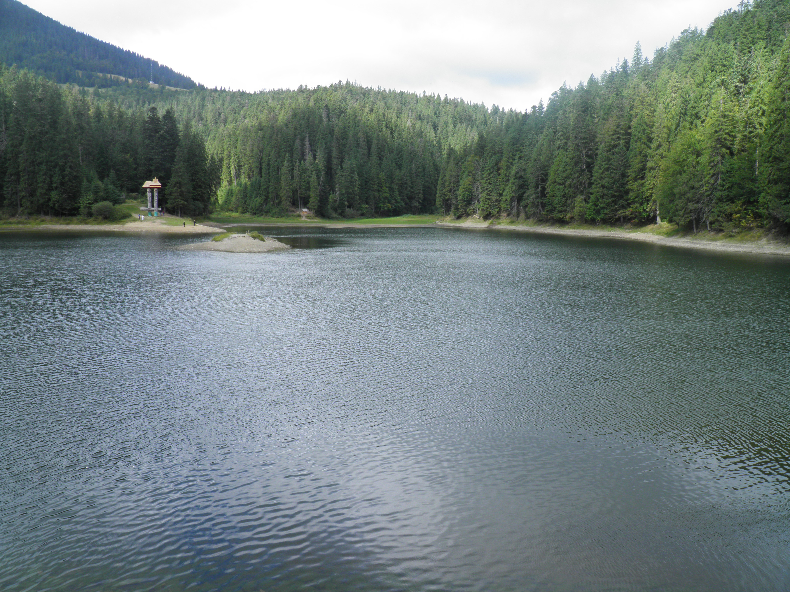
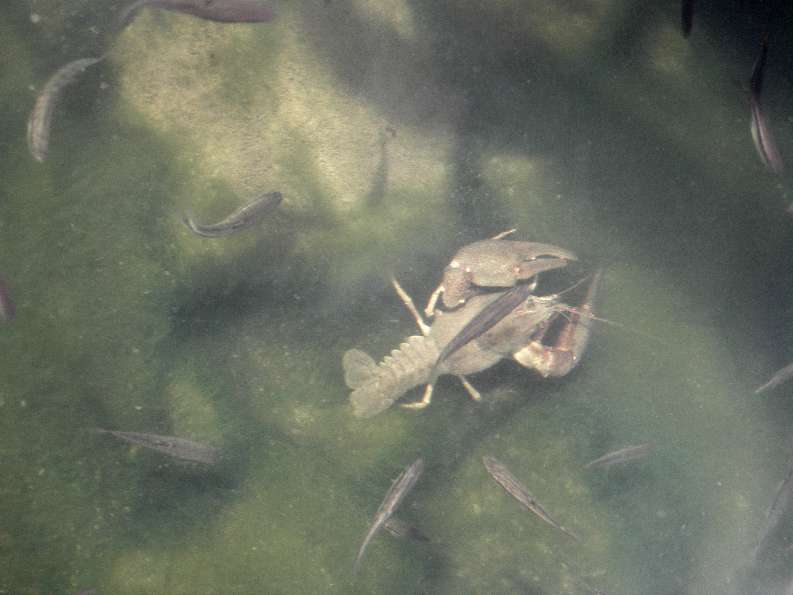

# Інформаційне «сміття» цифрового і нецифрового формату

## 🏫 Урок **17**

---

## 🛡️ Пригадуємо: техніка безпеки

- 🖥️ Сідаємо рівно, відстань до екрана — довжина витягнутої руки.
- 🚫 Без їжі, напоїв та верхнього одягу в кабінеті інформатики.
- 🔌 Не чіпаємо кабелі, роз'єми, задню панель монітора чи системного блока.
- ⚡ Не вмикаємо/вимикаємо комп'ютер самостійно, не відкриваємо системний блок.
- 🔥 Побачили дим, почули незвичний звук або сталася помилка — одразу повідомляємо вчителя.

---

## 🎯 Сьогодні ми дізнаємося

- 🚮 Що таке інформаційне «сміття» і яким воно буває.
- 🗑️ Як прибрати «сміття» на комп'ютері.
- 🔁 Як відстежити копії фото в інтернеті.
- 📷 Як відрізнити справжнє фото від фейкового.
- 🎬 Як перевірити відео, місце й час зйомки.

---

## 🗣️ Опитування: пригадуємо урок 16

🙋

Відповідаємо на запитання вчителя.

---

## 🧠 Подумаймо

Що станеться з кімнатою, якщо **місяць** не виносити сміття? 🤢

🏠 ➡️ 🗑️

А що буде з телефоном, у якому **5000 скріншотів**? 📱
А з головою, у яку щодня потрапляють **сотні неперевірених новин**? 🧠

---

## ✍️ Що таке інформаційне «сміття»?

**Інформаційне «сміття»** — будь-яка інформація, яка утворюється в процесі людської чи цифрової діяльності й **не має подальшого використання** внаслідок її особливостей.

Воно накопичується **в інтернеті** та **в різних сховищах** — і на диску, і в шафі. 📦

---

## 💻 Цифрове і 📜 нецифрове «сміття»

### 💻 Цифровий формат

- файли й сайти із **застарілою** чи **перекопійованою** інформацією
- дані, що займають **великі обсяги**
- **шкідливий** вміст: спам, фейки, клікбейт

### 📜 Нецифровий формат

- надмірна кількість **неважливих документів**
- **застарілі матеріали**, що втратили актуальність
- непотрібна **поштова реклама**

---

## ⚡ Бліц: цифрове чи нецифрове?

1. 📬 Рекламні листівки в поштовій скриньці
2. 📱 300 однакових скріншотів
3. 📋 Старий розклад уроків на дошці оголошень

4. 💬 Фейкова новина в месенджері
5. 📁 Папка «Завантаження», повна інсталяторів
6. 📰 Стос старих газет

📝 **Запишіть у зошит** означення та по 2 приклади кожного формату.

---

## 🔁 Розтиражовані копії

Одне й те саме фото чи текст розміщують на **сотнях сайтів** — це теж інформаційне «сміття». Серед копій важко знайти **оригінал і автора**.

🔎 **Пошук за зображенням** (Google, [TinEye](https://tineye.com)) показує:

- 🌐 де ще є це фото;
- 📅 **коли** воно з'явилося вперше (сортування «Oldest»);
- 🔀 як фото змінювали — і дозволяє порівняти з оригіналом.

---

## 📷 Справжнє фото чи фейк?

### 🔍 Деталі на фото

- перспектива, пропорції
- тіні та віддзеркалення
- фокус, контраст, кольори
- архітектура, погода, місцевість
- назви вулиць, номери авто

### 📢 Підпис до фото

- «**шок**», «**сенсація**»
- «**терміново**», «**неймовірно**»
- «**це фото видаляють звідусіль**»
- немає автора й першоджерела
- схожі «гучні» дописи на сайті

---

## 🕵️ Знайди підозріле

😱 **ШОК!!! ЦЕ ФОТО ВИДАЛЯЮТЬ ЗВІДУСІЛЬ!**
**Терміново** поширте, поки не пізно! **Неймовірно**, що таке приховують від нас!
🖼️ *[фото]*
👤 Автор: невідомий · 👁️ 1,2 млн переглядів за годину · 🔁 50 000 поширень

❓ Скільки ознак маніпуляції ви знайшли?

---

## 🏷️ Метадані фото (EXIF)

**Метадані** — прихована інформація всередині файлу фото.

- 📸 пристрій (камера, телефон)
- 🖌️ **програма**, у якій редагували
- 📅 дата й час зйомки
- ⚙️ параметри зйомки (експозиція)

👀 Де переглянути:

- Windows: **«Властивості» → «Докладно»**
- онлайн-сервіси (наприклад, Metadata2go)

---

## 🎬 Як перевірити відео?

### 👤 Джерело

- **Хто** опублікував? Чи справжній акаунт?
- Які ще відео поширює, **хто** коментує?
- ⚠️ Ненадійні: маловідомі блоги, неперевірені сторінки в соцмережах

### 🚩 Підозріло, якщо…

- відео **щойно** з'явилося, а вже має **сотні поширень** 🤖 (боти)
- чужий логотип **обрізано** чи **«замазано»** — фейк або плагіат

ℹ️ Існують сервіси, що збирають «цифровий слід» людини, — тому стежте за своїм!

---

## 📍 Місце і ⏰ час зйомки

### 📍 Де знято?

- порівняти з [Google Maps](https://maps.google.com) **Street View**
- геотеги інших фото з того місця
- зйомка у форматі 360°

### ⏰ Коли знято?

- афіші, вивіски
- ціни на пальне, курси валют
- 🌦️ **погода** — [Wolfram Alpha](https://www.wolframalpha.com)
  запит: `weather kyiv 23/07/2011`

---

## ✅ Чек-лист перевірки фото та відео

1. 👤 **Джерело** — хто автор?
2. 📢 **Підпис** — чи немає «шок», «терміново»?
3. 🔍 **Деталі** — тіні, віддзеркалення, логотипи.
4. 🔁 **Копії** — пошук за зображенням.
5. 🏷️ **Метадані** — пристрій, програма, дата.
6. 📍⏰ **Місце й час** — карти, погода.

📝 **Запишіть чек-лист у зошит!**

---

## ⌨️ Практична робота «Прибираємо і перевіряємо»

Працюємо **індивідуально**, відповіді записуємо **в зошит**.

| Рівень | Що виконати |
|---|---|
| 🥉 Середній | Завдання 1 |
| 🥈 Достатній | Завдання 1 + 2 + 3 |
| 🥇 Високий | Завдання 1 + 2 + 3 + 4 |

⚠️ Перевіряємо **лише фото за посиланнями зі слайдів**. Особисті фото на сайти **не завантажуємо**!

---

## 🗑️ Завдання 1. Генеральне прибирання Кошика

1. Відкрийте **Кошик** на Робочому столі, виділіть усі файли (**Ctrl+A**).
2. Запишіть із рядка стану **кількість файлів** та їхній **обсяг**.
3. Видаліть файл, який вкаже вчитель: права кнопка миші → **«Видалити»**.
4. Права кнопка миші на порожньому місці → **«Очистити кошик»**. Прочитайте попередження.

❓ Чи можна повернути файли після очищення Кошика?

---

## 🔁 Завдання 2. Де ще живе це фото?

Під час повені в соцмережах з'явилося фото: **«Акула пливе затопленою трасою!»** 🦈🛣️

1. Відкрийте [tineye.com](https://tineye.com) і вставте в поле пошуку адресу фото:
   https://upload.wikimedia.org/wikipedia/en/d/d6/%22Freeway_shark%22_hoax_image.png
2. Запишіть, **скільки** знайдено копій.
3. Відсортуйте за датою (**Oldest**). У якому **році** й на якому **сайті** фото з'явилося найраніше?

❓ Чи може це бути фото **сьогоднішньої** повені?

---

## 👀 Хвилинка для очей

👁️ ⏱️ 🌳

Правило **20-20-20**: кожні **20** хвилин дивіться **20** секунд на об'єкт, що віддалений на **20** футів (≈6 метрів).

---

## 🏷️ Завдання 3. Що приховують метадані?

Два фото озера Синевир зняв один автор одного дня. **Одне з них редагували. Яке?**

1. Відкрийте фото [«Синевир» 1](https://upload.wikimedia.org/wikipedia/commons/6/67/%C2%AB%D0%A1%D0%B8%D0%BD%D0%B5%D0%B2%D0%B8%D1%80%C2%BB1.JPG) і [«Синевир» 3](https://upload.wikimedia.org/wikipedia/commons/4/41/%C2%AB%D0%A1%D0%B8%D0%BD%D0%B5%D0%B2%D0%B8%D1%80%C2%BB3.JPG). Збережіть кожне: права кнопка миші → **«Зберегти зображення як…»**.
2. Права кнопка миші на файлі → **«Властивості»** → **«Докладно»**.
3. Запишіть: камера, дата зйомки, поле **«Програма»**.
4. Яке фото редагували? Як ви це визначили?
5. 🧹 Видаліть обидва файли із «Завантажень»!

Фото: Vimoculars, CC BY-SA 3.0, Wikimedia Commons

---

## 🌡️ Завдання 4. Мінус 20 у Береговому?

В інтернеті — відео із зимового відпочинку в **м. Берегове**: на початку **2024 р.** у снігових заметах люди купаються в гарячому басейні. Автор коментує: *«На вулиці −20°, у басейні +40°!»* ❄️♨️

1. Відкрийте [wolframalpha.com](https://www.wolframalpha.com) і введіть запит:
   `weather Berehove January 2024`
2. Запишіть **мінімальну** та **середню** температуру за місяць.
3. Чи могли бути такі умови насправді? Які ще ознаки варто перевірити у відео?

---

## 🗣️ Обговорюємо та підсумовуємо

- 🦈 Що ви дізналися про фото з акулою?
- 🌡️ Чи було −20° у Береговому?

🤔 Який інструмент із сьогоднішнього «набору прибиральника» ви використаєте **першим**, коли побачите сенсаційну новину?

---

## 🏠 Домашнє завдання

1. 📖 Опрацювати матеріал підручника, **с. 76–81**.
2. 🎬 Знайти в інтернеті відео **«Обережно: тонкий лід! Як зробити зимові розваги безпечними»** і перевірити його за чек-листом з уроку. Записати **3 аргументи**: чи можна йому довіряти?
3. 🧹 Удома «прибрати» свій телефон чи комп'ютер: непотрібні скріншоти, дублікати фото, файли із «Завантажень». Записати, **скільки місця** вдалося звільнити.

