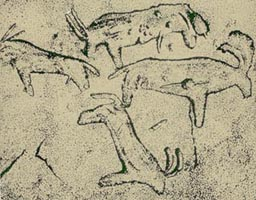

# 📨 Інформаційні процеси і системи: інформація, повідомлення

## 🏫 Урок **20**

---

## 🛡️ Пригадуємо: техніка безпеки

- 🖥️ Сідаємо рівно, відстань до екрана — довжина витягнутої руки.
- 🚫 Без їжі, напоїв та верхнього одягу в кабінеті інформатики.
- 🔌 Не чіпаємо кабелі, роз'єми, задню панель монітора чи системного блока.
- ⚡ Не вмикаємо/вимикаємо комп'ютер самостійно, не відкриваємо системний блок.
- 🔥 Побачили дим, почули незвичний звук або сталася помилка — одразу повідомляємо вчителя.

---

## 🎯 Сьогодні ми дізнаємося

- 📨 Що таке повідомлення і хто обмінюється повідомленнями.
- ℹ️ Як пов'язані повідомлення, інформація та дані.
- 🔇 Коли відомості стають шумом.
- 🔄 Які бувають інформаційні процеси.
- 🏢 З чого складається інформаційна система.

---

## 🤔 Розшифруй повідомлення

🌧️ ➡️ ⚽ ❌ 🏫 🏀

❓ Що означає це повідомлення? У вас 30 секунд!

❓ Чи всі зрозуміли його однаково? Чому?

---

## 📨 Повідомлення

**Повідомлення** — набір сигналів різної природи: звуків, тексту, зображень, жестів, графіків тощо.

👤 ➡️ 👤 **Людина — людині**
розмова, лист, жест

👤 ➡️ 🤖 **Людина — пристрою**
голосова команда смарт-колонці

🤖 ➡️ 👤 **Пристрій — людині**
сповіщення смартфона

🖥️ ➡️ 🖨️ **Пристрій — пристрою**
комп'ютер надсилає документ принтеру

🙊 **Передай без слів!** Отримувач може прийняти тільки **зрозуміле й доступне** повідомлення.

---

## ℹ️ Повідомлення та інформація

Людина сприймає не сам предмет чи явище, а **дані про нього**. Одне й те саме повідомлення різним людям несе **різну інформацію**.

<section class="grid-container">

🗿 **Кам'яна Могила** (поблизу Мелітополя) — заповідник із наскельними малюнками биків, козлів, мамонтів і носорогів. Їм — **тисячі років**!

Петрогліфи Кам'яної Могили (суспільне надбання, Wikimedia Commons)

</section>

❓ Що корисного дізнаються з цих малюнків 🎨 **художник**, 📜 **історик** і 🎒 **турист**?

---

## 💾 Дані

**Дані** — сукупність відомостей, які зафіксовано на деякому носії для зберігання, передавання та опрацювання. (англ. *data*, від лат. *datum* — «дане»)

**Носії даних:** 📄 папір, 🎞️ фотоплівка, 💿 диски, 💾 карти пам'яті, флешки, ☁️ хмарні сховища.

Дані фіксують органи чуття людини та пристрої: 📷 камера, 🎤 мікрофон, 🌡️ датчик, 🏷️ сканер штрихкодів.

🥛 **Етикетка**
Молоко пастеризоване 2,5 %, 900 г
Виготовлено: **05.11.2026**
Придатне до: **15.11.2026**
Зберігати при **+2…+6 °C**
Після відкриття спожити протягом **3 діб**

---

## 🔇 Коли відомості стають шумом?

Відомості, які не використовуються, стають **шумом**. Інформація може перетворюватися на шум і навпаки.

🚑 **Сирена швидкої:**
- хто чекає — «допомога приїхала»;
- водій — «звільни смугу»;
- перехожий — просто шум.

👍 **Інформація чи шум?** 👎
1. 🚆 Затримка потяга до Львова — для пасажира до Одеси.
2. 🌦️ Прогноз погоди — коли завтра фізкультура на стадіоні.
3. 🐱 Знижка на корм для котів — коли вдома немає тварин.
4. 📅 Розклад уроків на минулий тиждень.

---

## 🔄 Інформаційні процеси

🔍 **Пошук**
запит в інтернеті, за каталогом

📥 **Збирання**
спостереження, вимірювання, опитування, експеримент

🗂️ **Подання**
сортування, упорядкування, класифікація

🔒 **Зберігання й захист**
запис на носії, захист від втрати й пошкодження

⚙️ **Опрацювання**
порівняння, оцінювання, аналіз, перетворення

📤 **Передавання й використання**
від передавача до приймача, прийняття рішень

🙋 **Міні-дослідження класу:** «Які тварини є у вас вдома?» Які процеси ми виконаємо?

---

## 🏢 Інформаційна система

Пристрої разом із **програмами**, **засобами зв'язку**, **базами даних** і **людьми**, які їх обслуговують, становлять **інформаційну систему**.

**Складові:**
- 🖥️ апаратна складова
- 💿 програмна складова
- 🗄️ бази даних
- 📡 телекомунікації
- 👥 люди та процедури

**Цикл:** ⌨️ введення ➡️ ⚙️ опрацювання ➡️ 📺 виведення ➡️ 🔁 зворотний зв'язок

📒 **Приклад: електронний щоденник**
- 🖥️ комп'ютери, сервери, смартфони
- 💿 сайт і застосунок
- 🗄️ оцінки, розклад, ДЗ
- 📡 інтернет
- 👥 учителі, учні, батьки

---

<section class="task">

## 🧩 Завдання: Впізнай інформаційний процес

1. 🔗 Відкрий <a href="https://learningapps.org/56727590" target="_blank" rel="noopener noreferrer">вправу LearningApps</a> або відскануй QR-код.
2. 🧲 Перетягни кожну картку із ситуацією до відповідного **інформаційного процесу**.
3. ✅ Натисни кнопку перевірки та виправ картки, підсвічені червоним.
4. 🤝 Виконав? Поясни сусідові одну складну картку.

</section>

---

## 🏠 Домашнє завдання

1. 📖 Опрацювати конспект уроку.
2. 📚 Опрацювати матеріали підручника с. 88–91.
3. 🏷️ Знайти вдома етикетку будь-якого товару. Записати в зошит **3 приклади даних** з неї та яку інформацію з кожного можна отримати.
4. ⭐ *(за бажанням)* Виконати <a href="https://learningapps.org/view2507712" target="_blank" rel="noopener noreferrer">вправу «Дії та інформаційні процеси»</a>.

