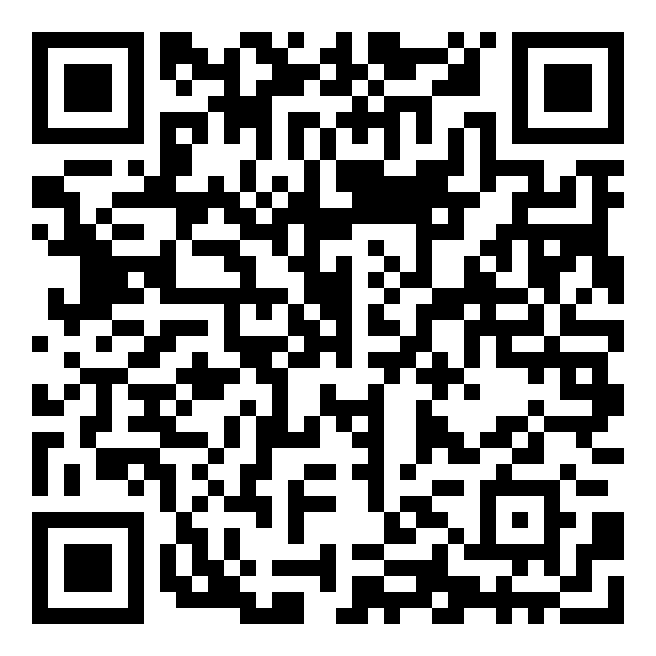

# Дані, знання

## 🏫 Урок **21**

---

## 🛡️ Пригадуємо: техніка безпеки

- 🖥️ Сідаємо рівно, відстань до екрана — довжина витягнутої руки.
- 🚫 Без їжі, напоїв та верхнього одягу в кабінеті інформатики.
- 🔌 Не чіпаємо кабелі, роз'єми, задню панель монітора чи системного блока.
- ⚡ Не вмикаємо/вимикаємо комп'ютер самостійно, не відкриваємо системний блок.
- 🔥 Побачили дим, почули незвичний звук або сталася помилка — одразу повідомляємо вчителя.

---

## 🎯 Сьогодні ми дізнаємося

- 💾 Що таке дані і що таке знання.
- 🔺 Як дані перетворюються на інформацію, знання і мудрість.
- 🔄 Як інформаційні процеси допомагають отримувати знання.
- ✅ Як ухвалювати рішення на основі даних.

---

## 🤔 Що означають ці числа?

38,5

37,8

37,2

36,6

❓ Що ви можете сказати про ці числа?

🌡️ А якщо це **температура тіла Олі**, виміряна щоранку протягом чотирьох днів?

💡 Що з цього випливає? Яке рішення можна ухвалити?

---

## 💾 Дані і 🧠 знання

**Дані** — це факти, цифри, текст або інші елементи, які ми можемо **зібрати та записати**.

📌 Числа 5, 10, 15; текст «Сонце сходить на сході».

**Знання** — це інформація, яку ми **розуміємо та усвідомлюємо**. Результат опрацювання даних та їх інтерпретації, що дає змогу робити висновки та розуміти зв'язки.

🌡️ Температура щодня протягом тижня ➡️ ⚙️ опрацювання ➡️ 🧠 «Температура зростає протягом цього тижня»

🧱 Дані — **будівельний матеріал**, знання — **продукт** їх опрацювання та інтерпретації.

---

## 🔺 Піраміда: від даних до мудрості

Мудрість

🎯 <b>застосування:</b> «Мені слід зупинитись»

Знання

🧩 <b>контекст:</b> «Для мене ввімкнувся заборонний сигнал»

Інформація

💡 <b>розуміння:</b> «На світлофорі ввімкнувся червоний сигнал»

Дані

👁️ <b>сприйняття:</b> «Бачу червоний колір»

⬆️ Кожен рівень спирається на попередній. **Дані** — «сирі» числа чи факти; **інформація** — дані з поясненням; **знання** — закономірність, висновок; **мудрість** — рішення, що варто зробити.

---

<section class="task">

## 🧩 Вправа: Збери піраміду

1. 🔗 Відкрий <a href="https://learningapps.org/display?v=pm1cjzjqj26" target="_blank" rel="noopener noreferrer">вправу LearningApps</a> або відскануй QR-код.
2. 🧲 Розклади картки в таблицю: для кожної ситуації визнач **дані**, **інформацію**, **знання** і **мудрість**.
3. ✅ Натисни кнопку перевірки та виправ картки, підсвічені червоним.
4. 🤝 Виконав? Допоможи сусідові — поясни свій вибір.

</section>

---

## 🔄 Інформаційні процеси та знання

📥 **1. Отримання даних**
основа для створення знань

⚙️ **2. Опрацювання даних**
виявляємо закономірності та зв'язки

🗄️ **3. Зберігання даних**
більше даних — нові й точніші знання

✅ **4. Використання знань**
обґрунтовані рішення

🚶 **Дорога до школи:** скільки хвилин і як ви сьогодні добиралися до школи? Запишемо дані, знайдемо закономірність і ухвалимо рішення!

---

<section class="task">

## 🧩 Завдання 1: Від даних до знань

👥 Працюємо в парах на <a href="https://padlet.com/yurasenko/19-s0259nd05ou2qpos8dmm" target="_blank" rel="noopener noreferrer">дошці Padlet</a>.

1. 🔢 Відкрий секцію з номером, який назвав учитель, і уважно розглянь дані.
2. ➕ Додай допис за схемою:
   - ℹ️ **Інформація:** що означають ці дані?
   - 🧠 **Знання:** яку закономірність ви помітили?
   - ✅ **Рішення:** що варто зробити?
3. ✍️ Підпиши допис своїми іменами.
4. 🔁 Встигли? Оберіть ще одну секцію на свій вибір.

</section>

---

## 🏠 Домашнє завдання

1. 📖 Опрацювати конспект уроку.
2. 📚 Опрацювати матеріали підручника с. 91–93.
3. 🔺 Записати в зошит власний приклад ланцюжка **«дані → інформація → знання → рішення»** з повсякденного життя (погода, спорт, навчання, покупки).
4. ⭐ *(за бажанням)* Завдання 10 підручника (с. 93): накреслити в зошиті схему чи ментальну карту того, як ви отримуєте інформацію, опрацьовуєте її і як вона перетворюється на знання.

