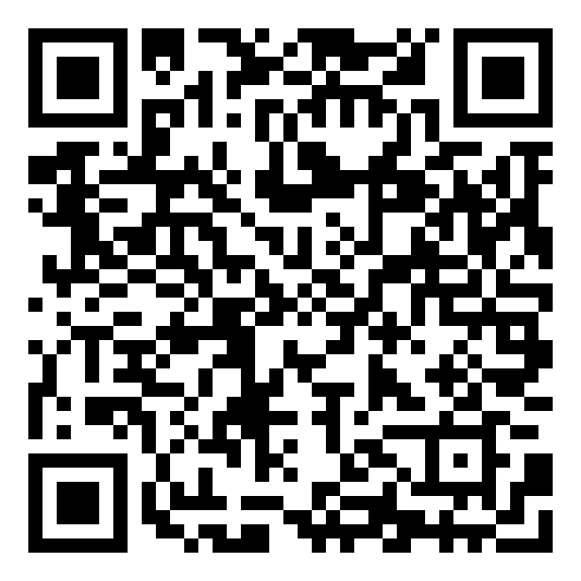

# 🗂️ Типи даних

## 🏫 Урок **22**

---

## 🛡️ Пригадуємо: техніка безпеки

- 🖥️ Сідаємо рівно, відстань до екрана — довжина витягнутої руки.
- 🚫 Без їжі, напоїв та верхнього одягу в кабінеті інформатики.
- 🔌 Не чіпаємо кабелі, роз'єми, задню панель монітора чи системного блока.
- ⚡ Не вмикаємо/вимикаємо комп'ютер самостійно, не відкриваємо системний блок.
- 🔥 Побачили дим, почули незвичний звук або сталася помилка — одразу повідомляємо вчителя.

---

## 🎯 Сьогодні ми дізнаємося

- 🗂️ Що таке типи даних.
- 🔢 Які бувають типи даних: числа, рядки, булеві значення, списки, кортежі, словники.
- ⚖️ Як порівнювати дані різних типів.
- ❓ Навіщо розрізняти типи даних.

---

## 🤔 Скільки буде?

`5 + 5`

`"5" + "5"`

🔢 `5 + 5` = **10** — додаємо числа.

🔤 `"5" + "5"` = **"55"** — у лапках не числа, а **текст**, і комп'ютер його «склеює».

❓ Як комп'ютер розуміє, що перед ним — число чи текст?

---

## 🫙 Що таке типи даних?

🧂 На кухні сіль, цукор, рис і гречку зберігають в **окремих підписаних ємностях**.

🏷️ Підпис підказує, що всередині і що з цим робити: цукор — у чай, сіль — у суп, рис і гречку — варять.

☕ Переплутали ємності — і чай солоний, хоча сіль і цукор схожі на вигляд!

💻 Так і в комп'ютері: `5` і `"5"` схожі на вигляд, але лежать у різних «ємностях».

🏷️ **Тип даних** — це «підпис на ємності».

📌 **Типи даних** — це спосіб сказати комп'ютеру, який саме вид даних ми збираємося використовувати. Від типу залежить, які значення можна зберігати і які дії з ними можна виконувати.

---

## 🔢 Прості типи даних

**🔢 Цілі числа**
числа без дробової частини
`1` · `10` · `−5`

**🪙 Дійсні числа**
числа з дробовою частиною (через **крапку**)
`3.14` · `−0.5` · `2.0`

**🔤 Рядки**
послідовності символів **у лапках**
`"Привіт!"` · `"12345"`

**🚦 Булеві значення**
лише два значення: правда або неправда
`True` · `False`

---

## 📦 Складені та інші типи даних

**📋 Списки** `[ ]`
набір елементів будь-якого типу, **можна змінювати**
`[1, 2, 3]` · `["яблуко", "груша", "слива"]`

**🔒 Кортежі** `( )`
як список, але **не змінюється** після створення
`(1, 2, 3)` · `("січень", "лютий", "березень")`

**📖 Словники** `{ }`
пари **«ключ — значення»**
`{"ім'я": "Василь", "вік": 12, "клас": 7}`

**📅 Інші типи — дати**
день, місяць і рік через крапку чи риску
`17.11.2026`

---

## ⚖️ Чи рівні?

🙋 Рівні чи ні? Підніми руку й поясни свою відповідь.

1. `5` і `"5"`
2. `[1, 2, 3]` і `[1, "2", 3]`
3. `(1, 2, 3)` і `{"a": 1, "b": 2, "c": 3}`
4. `5` і `5.0`
5. Яке булеве значення має умова `10 > 5`?

---

## ❓ Навіщо розрізняти типи даних?

**⚙️ Від типу залежать дії**
числа додаємо, рядки склеюємо, булеві значення відповідають «так чи ні?»
`5 + 5` → `10`
`"5" + "5"` → `"55"`

**🔀 Від типу залежить сортування**
числа: `2, 9, 10`
рядки: `"10", "2", "9"`
рядки порівнюються за першим символом, як слова в словнику

**🛑 Тип допомагає уникати помилок**
у поле «Вік» не можна ввести «дванадцять» — комп'ютер повідомить про помилку

🫙 Як підписана ємність не дає посолити чай, так і правильний тип даних не дає комп'ютеру виконати з даними хибну дію.

---

<section class="task">

## 🧩 Завдання 1: Розклади дані за типами

1. 🔗 Відкрий <a href="https://learningapps.org/display?v=p99f3r4cj26" target="_blank" rel="noopener noreferrer">вправу LearningApps</a> або відскануй QR-код.
2. 🧲 Перетягни кожне значення до групи — його типу даних.
3. 👀 Зверни увагу на **лапки**, **крапки** та **дужки**!
4. ✅ Натисни кнопку перевірки та виправ картки, підсвічені червоним.
5. 🤝 Виконав? Допоможи сусідові — поясни свій вибір.

</section>

---

<section class="task">

## 🕵️ Завдання 2: Детектив даних у смартфоні

📱 Досліди свій смартфон (немає телефона — працюй у парі). Записуй у **зошит**. 🔐 Лише технічні дані — без номерів, контактів і паролів!

**🟢 Середній рівень — «Знайди 4 прості типи».** Знайди по одному значенню кожного типу й запиши: що це, значення, тип.
🔢 **ціле число** (заряд батареї) · 🪙 **дійсне число** (зайнята пам'ять у ГБ) · 🔤 **рядок** (назва моделі чи Wi-Fi мережі) · 🚦 **булеве значення** (перемикач Wi-Fi чи Bluetooth)

**🟡 Достатній рівень — «Будильник — це словник».** Відкрий **Годинник** → будильник і запиши всі його налаштування як словник. Біля кожного значення вкажи тип.
`{"час": "07:30", "увімкнено": True, "дні": ["Пн", "Вт", "Ср"], "назва": "Школа", "відкласти_хв": 5}`

</section>

---

<section class="task">

## 🕵️ Завдання 2: Паспорт мого смартфона

**🔴 Високий рівень.** Відкрий **Налаштування → Про телефон** (Android) або **Параметри → Загальні → Про пристрій** (iPhone).

1. 📖 Склади словник-«паспорт» смартфона: щонайменше **7 пар** «ключ — значення» і **5 різних типів**, зокрема список і булеве значення.
2. ✍️ Поясни одним реченням, чому версія системи (`"17.1.2"`) — рядок, а не число.

`{"модель": "Galaxy A15", "версія_системи": "14", "пам'ять_ГБ": 128, "зайнято_ГБ": 54.3, "заряд": 64, "wifi_увімкнено": True, "застосунки": ["Камера", "Viber", "YouTube"]}`

</section>

---

## 🏠 Домашнє завдання

1. 📖 Опрацювати конспект уроку.
2. 📚 Опрацювати матеріали підручника с. 94–98.
3. 📖 Скласти в зошиті словник **«Про мене»**: щонайменше 6 пар «ключ — значення» різних типів (ім'я, вік, зріст у метрах, улюблені предмети — список, чи є домашня тварина — булеве значення, дата народження).
4. ⭐ *(за бажанням)* Завдання 6 підручника (с. 98): обрати одне із запитань про інформаційні системи та підготувати коротку презентацію з фактами й посиланнями на джерела.

