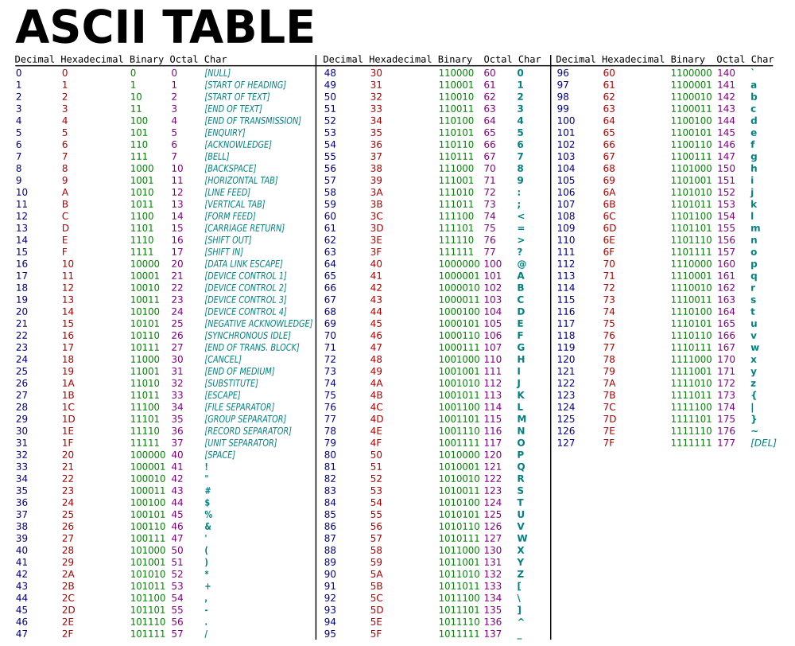

# Кодування та декодування. Двійкове кодування

## 🏫 Урок **24**

---

## 🛡️ Пригадуємо: техніка безпеки

- 🖥️ Сідаємо рівно, відстань до екрана — довжина витягнутої руки.
- 🚫 Без їжі, напоїв та верхнього одягу в кабінеті інформатики.
- 🔌 Не чіпаємо кабелі, роз'єми, задню панель монітора чи системного блока.
- ⚡ Не вмикаємо/вимикаємо комп'ютер самостійно, не відкриваємо системний блок.
- 🔥 Побачили дим, почули незвичний звук або сталася помилка — одразу повідомляємо вчителя.

---

## 🎯 Сьогодні ми дізнаємося

- 🔐 Що таке кодування і декодування.
- 💡 Чому комп'ютер «говорить» лише **0** та **1**.
- 🧱 Що таке **біт** і **байт**.
- 🔢 Як перетворювати числа з двійкової системи в десяткову і навпаки.
- 🔡 Як комп'ютер зберігає текст.

---

## 🕵️ Секретне повідомлення

`01001000 01000101 01001100 01001100 01001111`

🤖 Комп'ютер прочитає це **миттєво**. А ви — поки що ні… 😉
🎯 Наприкінці уроку ви його **розшифруєте**!

🤔 Як комп'ютер, у якому лише мікросхеми та електричний струм, «розуміє» літери, числа й картинки?

---

## 🔐 Кодування і декодування

**Кодування повідомлень** — процес перетворення за певними правилами одного подання набору даних в інше. Змінюється **вигляд** повідомлення, а **зміст** — ні.
**Декодування** — зворотний процес: перетворення коду на зрозуміле подання (наприклад, коду символу — на його зображення на екрані).

**⚡ Бліц «Що закодовано?»**
🎼 ноти · 🚸 дорожні знаки
📡 азбука Морзе `· — —`
🔳 QR-код · 🚦 світлофор

**🔄 Приклад**
✍️ Слово «SOS» → азбука Морзе:
`··· ——— ···`
👂 Отримувач **декодує** сигнал назад у слово

---

## 🧱 Двійкове кодування, біт і байт

**Двійкове кодування** — кодування повідомлень за допомогою двох сигналів (💡 є сигнал — **1**, ⚫ немає — **0**). Результат — **двійковий код**.
**Біт** (*binary digit* — двійкова цифра) — цифра **0** або **1** у двійковому коді. **Байт** — послідовність із **8 бітів**.

Скільки різних кодів можна скласти з *i* бітів: **N = 2ⁱ**

| бітів *i* | 1 | 2 | 3 | 4 | 5 | 6 | 7 | 8 |
|:---:|:---:|:---:|:---:|:---:|:---:|:---:|:---:|:---:|
| кодів *N* | 2 | 4 | 8 | 16 | 32 | 64 | 128 | **256** |

2 біти: `00` `01` `10` `11` — 4 чверті площини · 3 біти — 8 сторін горизонту 🧭

💡 **А ви знали?** Шрифт Брайля ⠃⠗⠁⠊⠇⠇⠑ — теж двійковий код: 6 точок, кожна опукла або ні → 2⁶ = **64** символи.

---

## 🔢 З двійкової системи в десяткову

**Двійкова система числення** — позиційна, з основою 2, цифри **0** і **1**. Нижній індекс позначає систему: 101₂, 5₁₀.
Кожну цифру множимо на її «вагу» — степінь двійки — і додаємо:

110001₂ = **1**·32 + **1**·16 + 0·8 + 0·4 + 0·2 + **1**·1 = **49₁₀**

🙋 **Живі біти!** 5 добровольців стають у ряд. Значення **зліва направо, як бачить клас**: **16 · 8 · 4 · 2 · 1**. Піднята рука — **1**, опущена — **0**.
1️⃣ Яке число: `10010`? 2️⃣ Покажіть числа **5**, **13**, **24**. 3️⃣ Яке **найбільше** число можна показати?

---

## ➗ З десяткової системи в двійкову

**Ділимо на 2 з остачею**, доки частка не стане меншою за 2:

| Ділення | Частка | Остача |
|:---:|:---:|:---:|
| 11 : 2 | 5 | **1** |
| 5 : 2 | 2 | **1** |
| 2 : 2 | **1** | **0** |

⬆️ Читаємо **знизу вгору**: остання частка + остачі
**11₁₀ = 1011₂**

✅ **Перевірка:**
1011₂ = 8 + 0 + 2 + 1 = 11₁₀

✍️ **Разом:** переведіть **25** у двійкову систему.

---

## 🔡 Як кодується текст?

⌨️ Натискаємо клавішу → у комп'ютер надходить **двійковий код** символу (1 символ = **1 байт** = 8 бітів → 256 символів) → 🖥️ на екрані код **декодується** в зображення символу.

**Таблиця кодування** встановлює відповідність між символами та їхніми кодами.

🌍 **ASCII** (1963 р.) — коди 0–127 однакові в усьому світі (латиниця, цифри, знаки), 128–255 — національні.
🇺🇦 **KOI8-U**, **Windows-1251** — з українськими літерами (1 байт). Інша таблиця → «кракозябри» 🤯

🌐 **Unicode** — 2 байти (16 бітів) → 2¹⁶ = **65 536** символів усіх алфавітів світу.
🚀 Сучасний Unicode — **до 4 байтів** на символ: понад 150 тисяч символів, зокрема емодзі 😀

---

## 📋 Таблиця ASCII

**Decimal** — десятковий код · **Binary** — двійковий (без нулів на початку: `1000001` = `01000001`) · **Char** — символ · 0–31 — службові коди, 32 — пробіл · 💡 код малої латинської літери = код великої + 32 · 🔍 <a href="https://commons.wikimedia.org/wiki/File:ASCII-Table.svg" target="_blank" rel="noopener noreferrer">Відкрити таблицю в повному розмірі</a>

---

<section class="task">

## 🎮 Завдання 1: Kahoot «Двійковий код»

1. 🔗 Відкрий <a href="https://kahoot.it" target="_blank" rel="noopener noreferrer">kahoot.it</a>.
2. 🔢 Введи **PIN гри**, який назве вчитель.
3. ✍️ Введи своє ім'я — реєстрація не потрібна.
4. ⚡ Відповідай на 10 запитань швидко й уважно!

🚫💻 **Без комп'ютера:** записуй у зошит відповіді на запитання, які зачитує вчитель, у форматі «номер — відповідь».

</section>

---

<section class="task">

## 🕵️ Завдання 2: Розшифруй секретне повідомлення

📓 Записуй у зошит: «Урок 24. Розшифруй секретне повідомлення». 🧮 **Калькулятор** → меню **☰** → **Програміст**. Клацни **BIN** і введи двійкове число — у рядку **DEC** буде десяткове (і навпаки).

1. ✅ **Перевір рівності.** Які правильні? Для неправильних запиши правильний результат:
   `1100001₂ = 98₁₀` · `36₁₀ = 100100₂`
2. 🔓 **Розшифруй повідомлення:** `01001000 01000101 01001100 01001100 01001111`
   Переведи кожен байт у десяткове число і знайди літеру в **таблиці ASCII** (стовпці **Decimal** і **Char**). Перевір себе за стовпцем **Binary**.

✍️ У зошит записуй **обчислення**, а не лише відповідь!

🚫💻 **Без комп'ютера:** ті самі завдання в зошиті — через **степені двійки** (16, 8, 4, 2, 1…) і **ділення на 2 з остачею**; літери шукай у таблиці ASCII.

</section>

---

## 🏠 Домашнє завдання

1. 📖 Опрацювати конспект уроку.
2. 📚 Опрацювати матеріали підручника с. 104–110.
3. 🎂 Перевести у двійкову систему свій **день і місяць народження** діленням з остачею та перевірити себе зворотним переведенням через степені двійки.
   *Приклад: 20 грудня → 20 = `10100₂`, 12 = `1100₂`*
4. ⭐ *(за бажанням)* 🕵️ **Шпигунське листування:** закодуй двійковим кодом за таблицею ASCII коротке слово латиницею (3–5 літер), дай розшифрувати рідним або другові. Чи вдалося? Скільки часу знадобилося?

