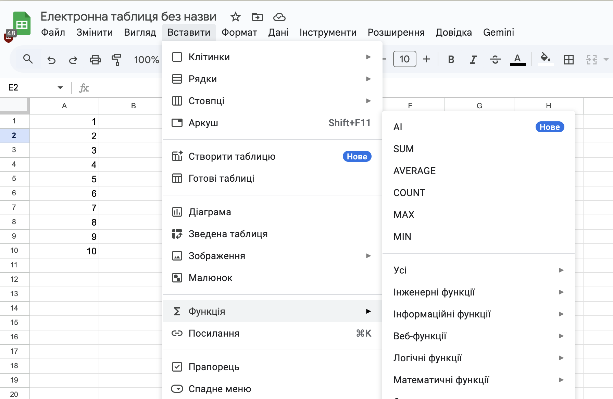

# 📊 Опрацювання табличних даних з використанням функцій

## 🏫 Урок **19**

---

## 🛡️ Пригадуємо: техніка безпеки

- 🖥️ Сідаємо рівно, відстань до екрана — довжина витягнутої руки.
- 🚫 Без їжі, напоїв та верхнього одягу в кабінеті інформатики.
- 🔌 Не чіпаємо кабелі, роз'єми, задню панель монітора чи системного блока.
- ⚡ Не вмикаємо/вимикаємо комп'ютер самостійно, не відкриваємо системний блок.
- 🔥 Побачили дим, почули незвичний звук або сталася помилка — одразу повідомляємо вчителя.

---

## 🎯 Сьогодні ми дізнаємося

- 🔁 Що ми вже знаємо про електронні таблиці та формули.
- ℹ️ Що таке функція та її аргументи.
- 🛠️ Як вставити функцію в Google Таблицях.
- 🔢 Які є математичні функції.
- 📈 Які є статистичні функції.
- 💰 Як фінансові функції рахують вклади й кредити.

---

## 🔁 Пригадуємо: електронні таблиці та формули

### 📋 Таблиця

- **Адреса клітинки** — стовпець + рядок: `B3`
- **Діапазон** — прямокутна група клітинок: `B3:B8`
- Табличні процесори: Google Таблиці, Excel, LibreOffice Calc

### 🧮 Формула

- Починається зі знака **`=`**
- Містить числа, адреси, знаки `+ − * / ^`, дужки, функції
- Копіюють **маркером автозаповнення** ⬛ у кутку клітинки

### 🔗 Посилання

- **Відносне** `B3` — змінюється під час копіювання
- **Абсолютне** `$B$3` — не змінюється
- Клавіша **F4** додає знаки `$`

🤔 `=B3+B4+B5+B6+B7+B8` — а якщо рядків **500**? Тоді допоможе **функція**: `=SUM(B3:B502)`

---

## ℹ️ Функція та її аргументи

**Функція** — вбудована в табличний процесор формула, яка має **ім'я** і обчислює значення за заданими **аргументами**.

`=ІМ'Я(аргумент1; аргумент2; …)`

- **Аргумент** — число, текст у лапках, адреса клітинки, діапазон або вираз.
- Аргументи пишуть у **дужках** і розділяють **`;`**

**Як вставити функцію:**
1. ⌨️ Ввести `=` та ім'я — з'явиться підказка.
2. 📋 Меню *Вставити* → *Функція* → категорія.
3. **Σ** на панелі інструментів.

---

## 🔢 Математичні функції

| Функція | Що обчислює | Приклад → результат |
|---|---|---|
| `SUM(діапазон)` | суму чисел | `=SUM(B3:B5)` → **132** |
| `ROUND(число; знаків)` | округлює до вказаної кількості знаків після коми | `=ROUND(3,456; 1)` → **3,5** |
| `ABS(число)` | модуль числа | `=ABS(-7)` → **7** |
| `MOD(ділене; дільник)` | остачу від ділення | `=MOD(17; 5)` → **2** |
| `POWER(число; степінь)` | степінь числа | `=POWER(2; 10)` → **1024** |
| `SQRT(число)` | квадратний корінь | `=SQRT(81)` → **9** |

📐 Для геометрії є й інші: `SIN`, `COS`, `TAN` (кут у радіанах), `PI()` — число π.

---

## 📈 Статистичні функції

### 📊 Приклад: хлопці в гуртках

У клітинках `B3:B8` — числа **56, 58, 18, 34, 12, 21**

| Формула | Що обчислює | Результат |
|---|---|---|
| `=AVERAGE(B3:B8)` | середнє значення | 33,1666… |
| `=MAX(B3:B8)` | найбільше | 58 |
| `=MIN(B3:B8)` | найменше | 12 |
| `=COUNT(B3:B8)` | кількість чисел | 6 |

### 🪆 Функція всередині функції

Середнє 33,1666… незручно читати — його треба **округлити**:

`=ROUND(AVERAGE(B3:B8); 1)`

1️⃣ Спочатку `AVERAGE` обчислює середнє → 33,1666…
2️⃣ Потім `ROUND` округлює його до **1** знака після коми → **33,2**

---

## 🔍 Статистичні функції: COUNTIF і RANK

### `COUNTIF(діапазон; умова)`

Рахує, **скільки** клітинок відповідає умові.

- `=COUNTIF(B3:G3; "н")` — скільки разів учень мав «н» (пропусків)
- `=COUNTIF(B2:B5; ">=80")` — скільки учасників мають 80 балів і більше → у таблиці праворуч **2**

### `RANK(значення; дані; 0)` — яке місце?

| | A | B | C |
|---|---|---|---|
| 1 | Учасник | Бали | Місце |
| 2 | Бондаренко | 74 | **3** |
| 3 | Гнатюк | 91 | **2** |
| 4 | Мельник | 95 | **1** |
| 5 | Остапенко | 47 | **4** |

`C2`: `=RANK(B2; $B$2:$B$5; 0)`
**B2** — чий бал · **$B$2:$B$5** — з ким порівнюємо · **0** — найбільший бал = 1 місце

📌 Діапазон у `RANK` пишемо з **`$`**, щоб під час автозаповнення до `C5` він не зсувався. Якщо замість 0 написати **1** — 1 місце отримає **найменше** значення (як у бігу на час).

---

## 💰 Фінансові функції

### 🐷 `FV` — скільки накопичу?

`FV(ставка; періодів; платіж)`

Відкладаємо **500 грн** щомісяця 12 місяців під **12 %** річних:

`=FV(12%/12; 12; -500)` → **6 341,25 грн**

Внесли 6 000 грн, відсотки — **341,25 грн** 🎉

### 📱 `PMT` — скільки платити щомісяця?

`PMT(ставка; періодів; сума_кредиту)`

Телефон за **12 000 грн** у розстрочку на 12 місяців під **24 %** річних:

`=PMT(24%/12; 12; -12000)` → **1 134,72 грн**

📌 Платежі щомісячні → річну ставку ділимо на **12**. Гроші, які ми **віддаємо**, пишемо зі знаком **мінус**.

---

<section class="task">

## ⌨️ Практична робота: Функції в Google Таблицях

🔗 <a href="https://docs.google.com/spreadsheets/d/11hzK9C46h7v24eM1qGkXBHeffbc1eNoIt7chttOxbVA/copy" target="_blank" rel="noopener noreferrer">Відкрити таблицю</a> → **Створити копію** → перейменуйте на `Урок19_Прізвище`. Заповнюйте **жовті** клітинки.

### 🟢 Середній — аркуш *Гуртки*

1. У клітинках `D3:D8` порахуй, скільки **всього учнів** (хлопців і дівчат) у кожному гуртку. Запиши формулу `=SUM(B3:C3)` лише в `D3`, а потім потягни **маркер автозаповнення** ⬛ вниз до `D8`.
2. У рядку *Разом* порахуй, скільки всього хлопців, дівчат і учнів відвідують гуртки: запиши `=SUM(B3:B8)` у `B9` і потягни маркер вправо до `D9`.
3. У рядках *Середнє*, *Найбільше*, *Найменше* запиши в стовпці B формули `=ROUND(AVERAGE(B3:B8); 1)`, `=MAX(B3:B8)`, `=MIN(B3:B8)` і потягни кожну маркером вправо до стовпця D.

### 🟡 Достатній — аркуш *Квіти*

4. З квітів кожної партії складають букети з однаковою кількістю квітів. У клітинках `E2:E9` порахуй, скільки квітів **залишиться** після складання букетів. Використай функцію `MOD` (остача від ділення) і маркер автозаповнення.
5. Порахуй, скільки квітів залишилося **всього** (`E10`), скільки партій склали в букети **без залишку** (`E11`, функція `COUNTIF`) і який **найбільший** залишок (`E12`).

</section>

---

<section class="task">

## ⌨️ Практична робота (продовження)

### 🔴 Високий — аркуші *Олімпіада* та *Скарбничка*

6. На аркуші *Олімпіада* визнач у стовпці *Місце*, яке місце посів кожен учасник: найбільше балів — 1 місце. Формулу запиши лише раз і скопіюй маркером автозаповнення.
7. Порахуй, скільки учасників набрали **80 балів і більше** (`F2`), і знайди **середній бал**, округлений до десятих (`F3`).
8. На аркуші *Скарбничка* порахуй, скільки грошей буде на депозиті **через рік** (`B5`), скільки потрібно **платити щомісяця** за ноутбук у розстрочку (`B11`) і яка **переплата** за ноутбук (`B12`).

   💬 Висновок: скільки «заробили» відсотки за вкладом і скільки «коштує» розстрочка?

⚠️ Формула з `;` видає помилку? *Файл* → *Налаштування* → *Мовний стандарт* → **Україна**.

</section>

---

## 🏠 Домашнє завдання

1. 📖 Опрацювати конспект уроку.
2. 📚 Опрацювати матеріали підручника **с. 76–81**.
3. 🧮 Завдання 5 (с. 80): у Google Таблицях створити таблицю степенів чисел від 1 до 10 — від **першого до п'ятого** степеня (функція `POWER`).
4. ✅ Пройти тест у **Classtime** — посилання в електронному щоденнику **НІТ**.

