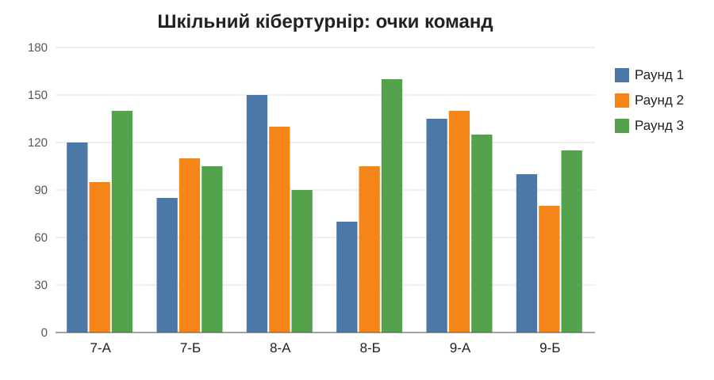

# Візуальне представлення даних. Діаграми. Вибір типу та побудова діаграм

## 🏫 Урок **23**

---

## 🛡️ Пригадуємо: техніка безпеки

- 🖥️ Сідаємо рівно, відстань до екрана — довжина витягнутої руки.
- 🚫 Без їжі, напоїв та верхнього одягу в кабінеті інформатики.
- 🔌 Не чіпаємо кабелі, роз'єми, задню панель монітора чи системного блока.
- ⚡ Не вмикаємо/вимикаємо комп'ютер самостійно, не відкриваємо системний блок.
- 🔥 Побачили дим, почули незвичний звук або сталася помилка — одразу повідомляємо вчителя.

---

## 🎯 Сьогодні ми дізнаємося

- 📈 Що таке діаграма і з яких складових вона складається.
- ➕ Як додати діаграму до таблиці в Google Таблицях.
- 🎨 Як налаштувати діаграму в Редакторі діаграм.
- 📊 Як обрати тип діаграми відповідно до даних.

---

## 🎮 Шкільний кібертурнір

| Команда | Раунд 1 | Раунд 2 | Раунд 3 |
|---|---|---|---|
| 7-А | 120 | 95 | 140 |
| 7-Б | 85 | 110 | 105 |
| 8-А | 150 | 130 | 90 |
| 8-Б | 70 | 105 | 160 |
| 9-А | 135 | 140 | 125 |
| 9-Б | 100 | 80 | 115 |

🤔 Яка команда **щораунду покращувала** свій результат? Де відповідь видно швидше — у таблиці чи на діаграмі?

---

## 📈 Діаграма та її складові

**Діаграма** — графічне зображення, що наочно відображає співвідношення між числовими даними за допомогою геометричних фігур.

- 🏷️ **Назва діаграми** — про що діаграма.
- 🎨 **Легенда** — який колір відповідає якому ряду даних.
- 🔢 **Підписи даних** — значення біля фігур.

- ↔️ **Вісь категорій** (горизонтальна) — команди, дні, назви.
- ↕️ **Вісь значень** (вертикальна) — числа.
- 🖼️ **Область діаграми** та **область побудови**.

---

## ➕ Як додати діаграму до таблиці

1. 🖱️ Виділити **джерело даних** — діапазон **разом із заголовками** (наприклад, `A1:D7`).
2. 📊 Меню **Вставлення** → **Діаграма**.
3. 🛠️ Праворуч відкриється **Редактор діаграм** — Google Таблиці самі запропонують тип діаграми.
4. ↔️ Діаграму можна **перемістити**, змінити **розмір** (тягнути за маркери) або **видалити** (`Delete`).

✏️ Повторно відкрити Редактор діаграм: **подвійне клацання** по діаграмі або **⋮** → **Змінити діаграму**.

---

## 🎨 Редактор діаграм

### ⚙️ Налаштування
- **Тип діаграми** — список усіх типів.
- **Діапазон даних** — джерело даних.
- **Вісь X**, **ряди** даних.
- Вид: звичайна, **з накопиченням**, нормована.

### 🖌️ Оформлення
- **Заголовки діаграми й осей** — назва, підписи осей.
- **Легенда** — розташування, шрифт.
- **Ряд даних** — колір, підписи даних.
- **Кругова діаграма** → мітка сегмента → **Відсоток**.

---

## 📊 Який тип діаграми обрати?

| Що хочемо показати? | Тип діаграми | Приклад |
|---|---|---|
| Порівняння значень | 📊 **Стовпчаста** (гістограма) | Очки команд за раунди |
| Порівняння, довгі назви категорій | 📶 **Лінійчата** | Хвилини на день у різних застосунках |
| Частки цілого (100 %), **один ряд даних** | 🥧 **Кругова** | Улюблені жанри ігор у класі |
| Зміна з часом, тенденція | 📈 **Графік** | Глядачі трансляції по днях |
| Порівняння за кількома показниками | 🕸️ **Пелюсткова** | Сила, швидкість, захист героїв гри |

⚠️ **З накопиченням** — показує внесок кожної частини в загальну суму. Кругова діаграма **не підходить** для кількох рядів даних і змін у часі.

---

<section class="task">

## 🧩 Завдання 1: Яку діаграму обрати?

1. Відкрий <a href="https://kahoot.it" target="_blank" rel="noopener noreferrer">kahoot.it</a>.
2. Введи **PIN-код**, який назве вчитель, і своє ім'я.
3. Читай запитання на своєму екрані й обирай правильну відповідь — швидкість теж важлива! ⏱️

</section>

---

<section class="task">

## ⌨️ Завдання 2: Медалі параолімпійців України

Створи Google Таблицю (<a href="https://sheets.new" target="_blank" rel="noopener noreferrer">sheets.new</a>) і назви її `Урок23_Прізвище`.

| Ігри | Золото | Срібло | Бронза |
|---|---|---|---|
| 2016 Ріо | 41 | 37 | 39 |
| 2020 Токіо | 24 | 47 | 27 |
| 2024 Париж | 22 | 28 | 32 |

1. Введи дані в діапазон `A1:D4`.
2. Додай **стовпчасту** діаграму.
3. Оформи: назва «Медалі параолімпійців України», підписи осей «Ігри» і «Кількість медалей», легенда **знизу**, кольори рядів — 🟡 золотий, ⚪ сірий, 🟤 коричневий.
4. Зміни вид на **стовпчасту з накопиченням**. На яких Іграх медалей **найбільше**? Запиши відповідь у `A6`.

</section>

---

## 🏠 Домашнє завдання

1. 📖 Опрацювати конспект уроку.
2. 📚 Опрацювати матеріали підручника **с. 87–96**.
3. 📊 Завдання 5 (с. 90): проаналізувати діаграму «Топ-5 найпопулярніших посад» за поданою схемою, відповіді записати в зошит.
4. 👨‍👩‍👧 *(За бажанням)* Завдання 9 (с. 95): запитати в батьків або знайомих, який тип діаграм вони використовують найчастіше і для чого.

