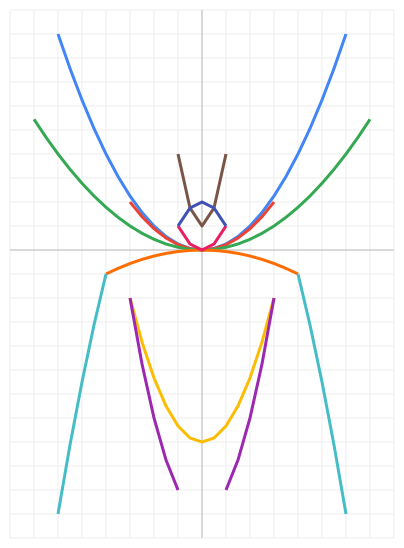
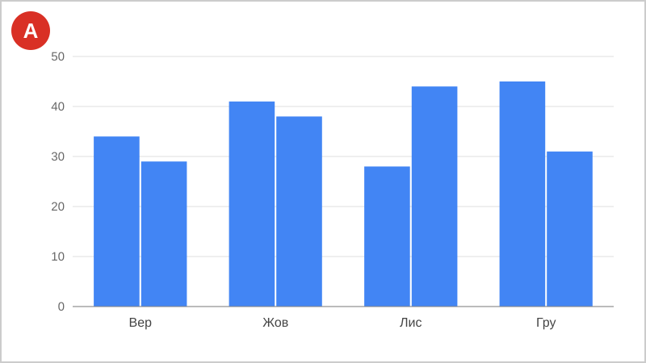
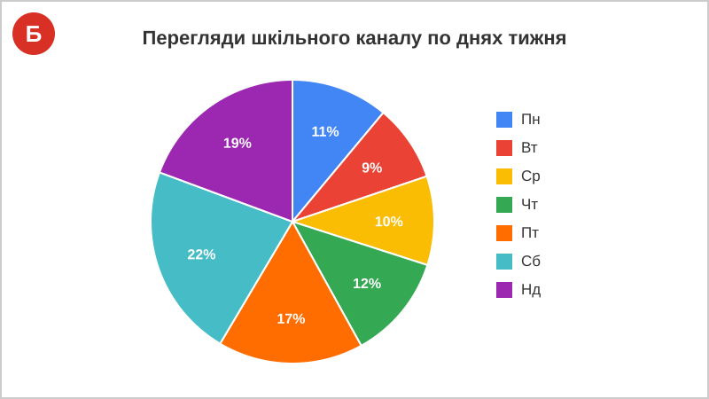
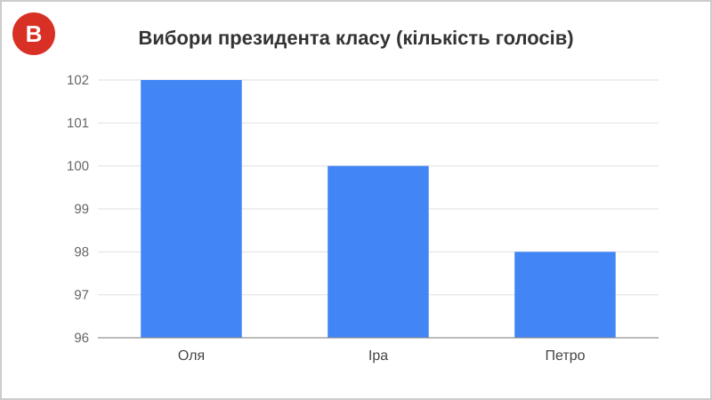
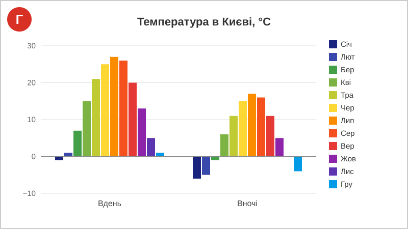

# Зображення рядів даних

## 🏫 Урок **24**

---

## 🛡️ Пригадуємо: техніка безпеки

- 🖥️ Сідаємо рівно, відстань до екрана — довжина витягнутої руки.
- 🚫 Без їжі, напоїв та верхнього одягу в кабінеті інформатики.
- 🔌 Не чіпаємо кабелі, роз'єми, задню панель монітора чи системного блока.
- ⚡ Не вмикаємо/вимикаємо комп'ютер самостійно, не відкриваємо системний блок.
- 🔥 Побачили дим, почули незвичний звук або сталася помилка — одразу повідомляємо вчителя.

---

## 🎯 Сьогодні ми дізнаємося

- 🔁 Як додати діаграму та налаштувати її основні складові (повторення).
- 📊 Що таке **ряди даних** і **категорії** діаграми.
- 🔀 Як додавати ряди та міняти місцями рядки й стовпці.
- 🎨 Як змінити вигляд окремого ряду, точки чи осі діаграми.

---

## 🕷️ Що це за малюнок?

🤔 Як ви думаєте, **де** намальовано цей малюнок?

💡 Це **діаграма** з електронної таблиці! Вона складається з 10 графіків — кожен із них окремий **ряд даних** зі своїм кольором.

🏠 Як отримати такий малюнок — дізнаєтеся вдома (ДЗ за бажанням).

---

## 🎬 Дивимося відео (1–4)

**1. Як додати діаграму**
⏱️ 1:46

▶️ <a href="https://www.loom.com/share/cf393c65edc14185b39b54bb2e493527" target="_blank" rel="noopener noreferrer">Дивитися</a>

**2. Налаштовуємо зовнішній вигляд**
⏱️ 2:33

▶️ <a href="https://www.loom.com/share/e3f7a424082c416a83fd325ba84d98c9" target="_blank" rel="noopener noreferrer">Дивитися</a>

**3. Ряди даних і категорії**
⏱️ 2:06

▶️ <a href="https://www.loom.com/share/a9c707b52da24cf7aa1dfe5b23143675" target="_blank" rel="noopener noreferrer">Дивитися</a>

**4. Міняємо місцями рядки і стовпці**
⏱️ 1:15

▶️ <a href="https://www.loom.com/share/e71127d2093448ca8a360b7761b943b9" target="_blank" rel="noopener noreferrer">Дивитися</a>

🎧 Навушники! Під час перегляду знайдіть відповіді: **1)** що таке ряд даних; **2)** де змінити колір лінії ряду. 📱 QR-код відкриває відео на телефоні.

---

## 🎬 Дивимося відео (5–8)

**5. Діаграма як об'єкт**
⏱️ 0:58

▶️ <a href="https://www.loom.com/share/e6d43ceb0c2e48ada4b7de7b050f77c7" target="_blank" rel="noopener noreferrer">Дивитися</a>

**6. Оформлення рядів**
⏱️ 1:14

▶️ <a href="https://www.loom.com/share/e8befe92c28f4412bd28112a2279f5ec" target="_blank" rel="noopener noreferrer">Дивитися</a>

**7. Осі**
⏱️ 1:31

▶️ <a href="https://www.loom.com/share/46d3d03d334b450e93af6e0afc4080f0" target="_blank" rel="noopener noreferrer">Дивитися</a>

**8. Швидке налаштування діаграми**
⏱️ 0:48

▶️ <a href="https://www.loom.com/share/f94c33c123b84e8ebe68315a9651c980" target="_blank" rel="noopener noreferrer">Дивитися</a>

⏩ Не встигаєте? Увімкніть швидкість **1,2×** у налаштуваннях відео.

---

## 📌 Головне

- **Ряд даних** — набір значень однієї величини, які на діаграмі зображено однаково (одним кольором, однією лінією). Назва ряду — у **легенді**.
- **Категорії** — підписи значень на горизонтальній осі.
- Додати діаграму: виділити дані **разом із заголовками** → **Вставлення → Діаграма**.
- **Редактор діаграм**: *Налаштування* — **що** показує діаграма (тип, дані, ряди); *Оформлення* — **як** вона виглядає (заголовки, легенда, ряди, осі).
- Швидкий спосіб — **двічі клацнути** потрібну складову діаграми.

---

<section class="task">

## 🧩 Завдання 1: Лікарня діаграм 🏥

Відкрий <a href="https://kahoot.it" target="_blank" rel="noopener noreferrer">kahoot.it</a>, введи **PIN-код** від вчителя та своє ім'я. Для кожної «хворої» діаграми обери **діагноз** 🩺 і **лікування** 💊.

</section>

---

<section class="task">

## ⌨️ Завдання 2: Кліматичний паспорт Києва 🌡️

1. 📋 Відкрий <a href="https://docs.google.com/spreadsheets/d/1mtVacPisTTuriM2e_nYk9ZwrAJSqsfCwxG4YGYSDqHU/copy" target="_blank" rel="noopener noreferrer">таблицю з даними</a> і натисни **Зробити копію**.
2. ✏️ Перейменуй копію на `Урок24_Прізвище`.

У таблиці вже є середня температура в Києві (°C) по місяцях — `A1:C13`:

| Місяць | Вдень | Вночі |
|---|---|---|
| Січ | -1 | -6 |
| … | … | … |
| Лип | 27 | 17 |
| … | … | … |
| Гру | 1 | -4 |

### 🟢 Середній
1. Побудуй діаграму **Графік** з двома рядами.
2. Назва «Клімат Києва: температура вдень і вночі», осі «Місяць» і «Температура, °C», легенда **знизу**.

### 🟡 Достатній
1. `D1` — `Середня`, `D2` — `=AVERAGE(B2:C2)`, скопіюй до `D13`.
2. **Додай ряд** «Середня» до діаграми.
3. Кольори: «Вдень» 🔴, «Вночі» 🔵, «Середня» ⚪ **пунктир**; точки 7 px.

</section>

---

<section class="task">

## ⌨️ Завдання 2 (продовження)

### 🔴 Високий

1. 🏷️ Увімкни **мітки даних** для ряду «Вдень».
2. 🌞 Виділи найтеплішу точку (липень) іншим кольором і більшим розміром: *Ряд даних → Форматувати точку даних → Додати*.
3. 🔀 Скопіюй діаграму (`Ctrl+C` / `Ctrl+V`). У копії **поміняй місцями рядки й стовпці** і зміни тип на **стовпчасту**.
4. ✍️ У `F1` запиши: скільки рядів даних стало і яка з двох діаграм краще показує зміну температури протягом року?

</section>

---

## 🏠 Домашнє завдання

1. 📖 Опрацювати конспект уроку.
2. 📚 Опрацювати матеріали підручника **с. 96–98**.
3. 🌡️ Завершити практичну роботу «Кліматичний паспорт Києва» (до 🟡 достатнього рівня включно).
4. 🕷️ *(За бажанням)* Завдання 14 (с. 96): побудувати в Google Таблицях графіки функцій (крок 0,5) на одній діаграмі й з'ясувати, яке зображення вони утворюють.

