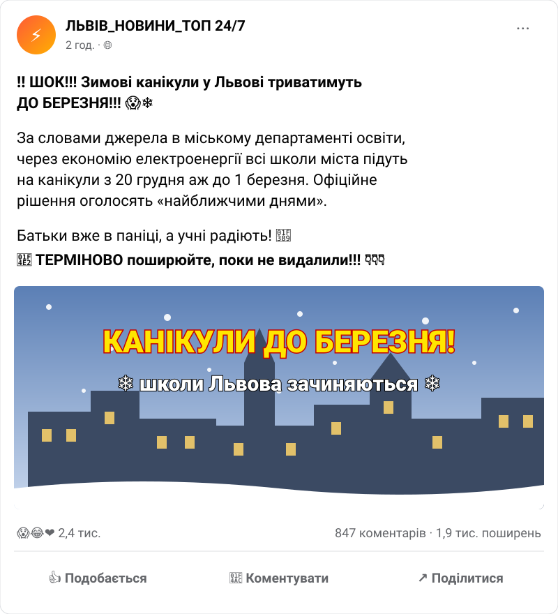

# Інструменти для виявлення фейків

## 🏫 Урок **18**

---

## 🛡️ Пригадуємо: техніка безпеки

- 🖥️ Сідаємо рівно, відстань до екрана — довжина витягнутої руки.
- 🚫 Без їжі, напоїв та верхнього одягу в кабінеті інформатики.
- 🔌 Не чіпаємо кабелі, роз'єми, задню панель монітора чи системного блока.
- ⚡ Не вмикаємо/вимикаємо комп'ютер самостійно, не відкриваємо системний блок.
- 🔥 Побачили дим, почули незвичний звук або сталася помилка — одразу повідомляємо вчителя.

---

## 🎯 Сьогодні ми

- 🔎 Опануємо метод швидкої перевірки **SIFT**.
- 🖼️ Навчимося шукати **за зображенням** за допомогою Google Lens і ШІ.
- 🔬 Дізнаємося про метод глибокого розслідування **5W1H**.
- ⌨️ Попрацюємо **медіадетективами**: перевіримо допис і чотири фото.

---

## 🔄 Пригадаймо

- 🕵️ Що таке **фейк**, **діпфейк**, **маніпуляція**?
- 🐞 Які **«баги» мозку** використовують творці фейків? Наведіть приклад.
- 🚩 Назвіть 3–4 **ознаки фейку**.
- 🧭 Які кроки **алгоритму перевірки** повідомлення ми вивчили?

---

## 📡 Історія одного фейку

🦠 2020 рік, початок пандемії COVID-19. У соцмережах поширюються дописи й відео: **вежі зв'язку 5G «викликають коронавірус»**. Хештеги **#5GKills** та **#Stop5G**.

🔥 Наслідки у Великій Британії: люди **підпалювали вежі 5G**, пошкодили зв'язок зі **швидкою допомогою**, нападали на інженерів.

✅ Фейк викрили науковці, фактчекери (**FullFact.org**) та офіційні заяви уряду.

❓ Як би ви діяли на місці фахівця з кіберзахисту? Що можна було перевірити, **перш ніж поширити** такий допис?

---

## 🧰 Набір медіадетектива

🪄 Чарівної кнопки «перевірити фейк» **не існує**. Але є методи й інструменти, які перетворюють пасивного читача на **медіадетектива**.

🔎 **SIFT**
«Швидкий сканер» на кожен день

🖼️ **Пошук за зображенням**
Звідки це фото?

🔬 **5W1H**
«Мікроскоп» для глибокого розслідування

---

## 🔎 Метод SIFT

✋ <b class="acronym-letter">S</b>top — Зупинись

🕵️ <b class="acronym-letter">I</b>nvestigate the source — Досліди джерело

📰 <b class="acronym-letter">F</b>ind better coverage — Знайди краще висвітлення

🧵 <b class="acronym-letter">T</b>race claims — Простеж до оригіналу

---

## ✋ S · 🕵️ I

✋ **Зупинись.** Найголовніший крок! Перш ніж клікати, репостити чи обурюватися — **зроби паузу**. Фейки розраховані на миттєву емоційну реакцію.
❓ *Які емоції викликає в мене цей допис?*

🕵️ **Досліди джерело.** Відкрий **нову вкладку** й введи в пошук назву сайту, сторінки чи ім'я автора.
❓ *Це авторитетне ЗМІ з історією чи «сайт-одноденка»? Цей «експерт» справді фахівець у цій темі?*

---

## 📰 F · 🧵 T

📰 **Знайди краще висвітлення.** Найпотужніший крок! Що про цю подію пишуть **інші надійні ЗМІ** та **офіційні джерела**?
✅ Пишуть кілька відомих видань — швидше за все, правда.
🚩 Кричить лише один сайт, а всі мовчать — майже напевно **фейк**.

🧵 **Простеж до оригіналу.** Знайди **першоджерело** цитати, фото чи відео.
📸 Фото «жахливих руйнувань» може виявитися знімком п'ятирічної давнини з іншої країни.

---

## 🖼️ Пошук за зображенням: Google Lens

❓ **Що це?**
Сервіс Google, який знаходить, **де ще** в інтернеті є це зображення, чи воно **оригінальне** і **що на ньому**.

⚙️ **Як працює?**
- 🌐 [images.google.com](https://images.google.com) → 📷 значок камери → завантаж фото.
- 🖱️ Або в Chrome: **правий клік** на фото → пункт пошуку через **Google Lens**.

🔍 Результат: сайти з цим фото, **схожі зображення**, назва об'єкта чи місця. Старі публікації фото допомагають з'ясувати, **коли** воно з'явилося.

---

## 🤖 Помічник ШІ в пошуку

💬 Після пошуку за зображенням можна **поставити запитання** про фото:
- «Що це за місце?»
- «Де зроблено це фото?»
- «Що це за будівля?»

⚠️ **ШІ теж помиляється** і може «вигадувати» відповіді. Відповідь ШІ — це **підказка**, яку треба **підтвердити джерелами** (крок **F**).

---

## 🔬 Метод 5W1H

| Запитання | Що з'ясовуємо |
|---|---|
| 👤 **Who? — Хто?** | Хто автор і хто опублікував? Чи є контакти, імена журналістів? |
| 📄 **What? — Що?** | Що саме стверджують? Які докази: документи, номери законів, імена? |
| 📅 **When? — Коли?** | Коли опубліковано? Чи не «консерва» це — стара новина, яку поширюють знову? |
| 📍 **Where? — Де?** | Де відбуваються події? Чи пишуть про це місцеві та інші ЗМІ? |
| 🎯 **Why? — Чому?** | Навіщо це створено: інформувати чи викликати гнів, страх, зібрати перегляди? |
| 🎭 **How? — Як?** | Як подано: спокійно й збалансовано чи мовою маніпуляції («ШОК!»)? |

---

## ⚖️ SIFT чи 5W1H?

🔎 **SIFT**
Швидке щоденне «патрулювання» стрічки новин

🔬 **5W1H**
Глибоке розслідування найважливіших і найпідозріліших випадків

✋ **Не довіряй — перевіряй!**

---

## 👀 Пауза для очей

Правило **20-20-20**: кожні 20 хвилин дивіться 20 секунд на предмет на відстані 20 футів (≈ 6 м).

---

## ⌨️ Практика 1: метод SIFT

🔎 Перевірте допис за кроками **SIFT**, користуючись пошуком в інтернеті.

📝 Запишіть у зошит:
- ✋ **S:** що в дописі тисне на емоції?
- 🕵️ **I:** що ви дізналися про джерело?
- 📰 **F:** що пишуть офіційні джерела та надійні ЗМІ?
- 🧵 **T:** звідки взялося твердження? Чи є оригінал?
- ✅ **Висновок:** фейк чи правда?

---

## ⌨️ Практика 2: «Де це знято?»

1. 📂 Відкрийте папку з фото: [🔗 Google Диск](https://drive.google.com/drive/folders/1KZUCqJtRZlYaJ7rhz6XBHvnM5XPxF4pl?usp=sharing)
2. 🖼️ Для кожного з **4 фото** скористайтеся **Google Lens** і **помічником ШІ**.
3. ❓ З'ясуйте: **що** зображено і **де** зроблено фото (місто, країна, назва об'єкта).
4. ✅ Підтвердьте відповідь ШІ **джерелом** (сайт, карта, інші фото).

📝 Таблиця в зошиті: **№ фото — що зображено — де зроблено — джерело підтвердження**

---

## 📊 Обговорюємо результати

- 🔎 Що ви з'ясували на кожному кроці **SIFT**? Який висновок?
- 🖼️ Що зображено на фото і де їх зроблено?
- 🤖 Чи помилився **ШІ** хоча б раз? Як ви це помітили?
- 🧩 Яке фото було найскладнішим? Що допомогло?

---

## 🗣️ Рефлексія

🤔

Продовжіть речення:
**«Тепер, коли я бачу сенсаційну новину, я першим ділом...»**

---

## 🏠 Домашнє завдання

1. 📖 Опрацювати матеріал підручника, **с. 60–61**.
2. 🎬 Переглянути серію 8 серіалу **«ДезінFAKEція»** (Дія.Освіта): [▶️ Серія 8](https://www.youtube.com/watch?v=Tkhm7Y4yNRo)

