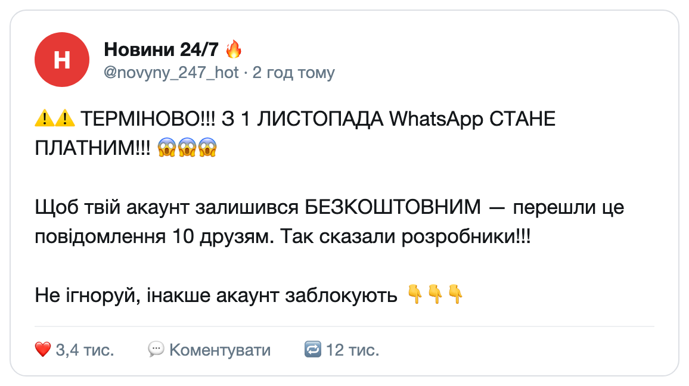
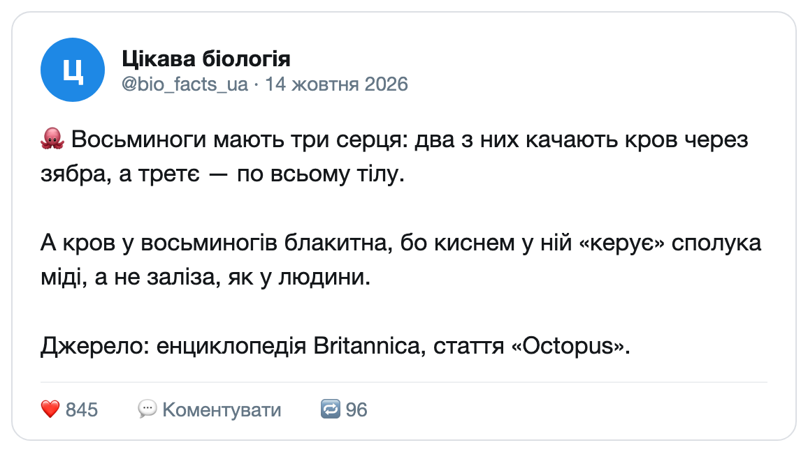
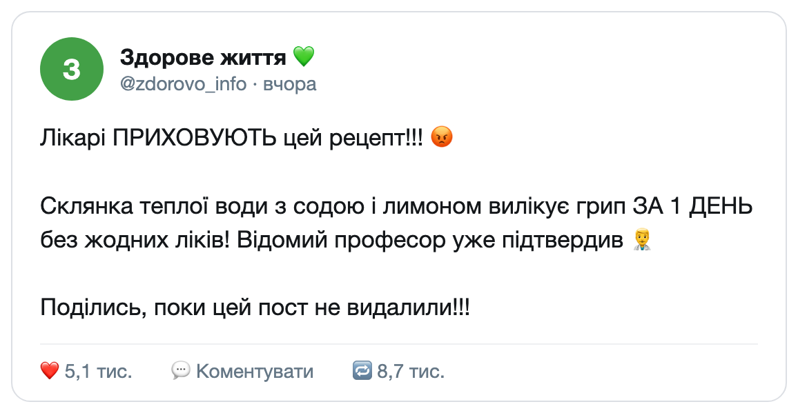
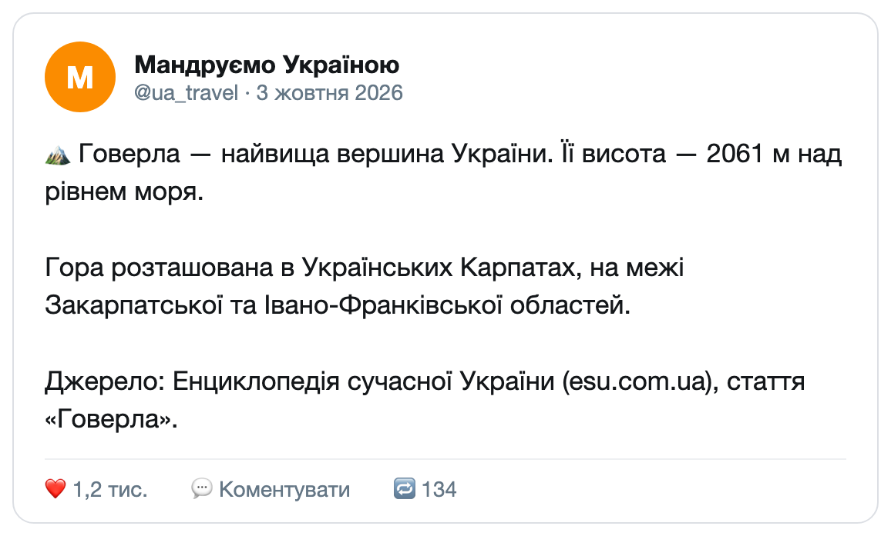
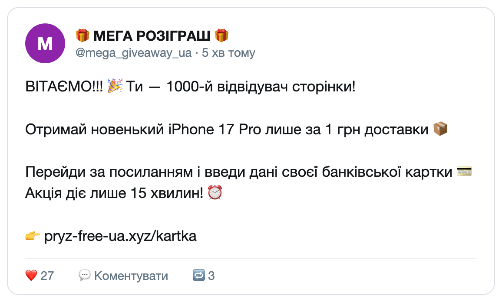
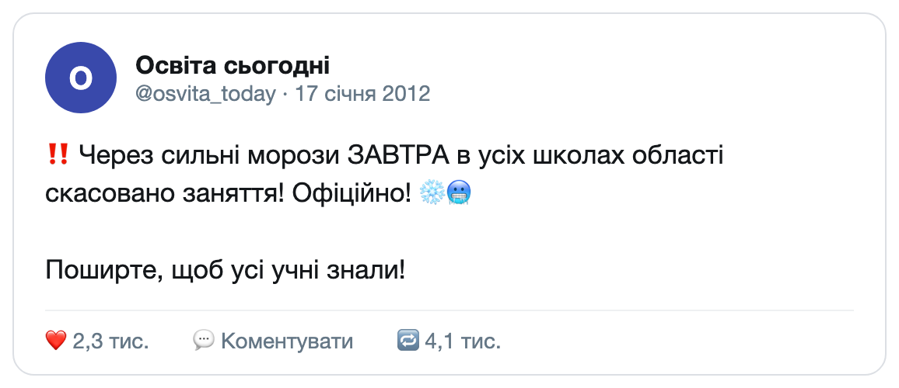
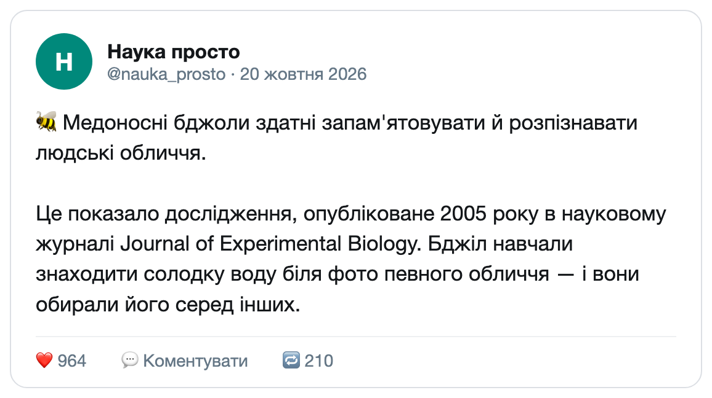
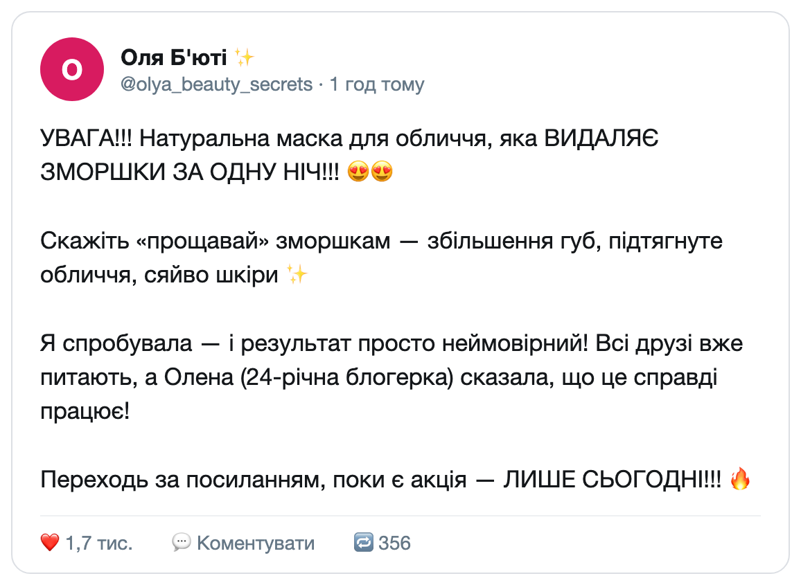
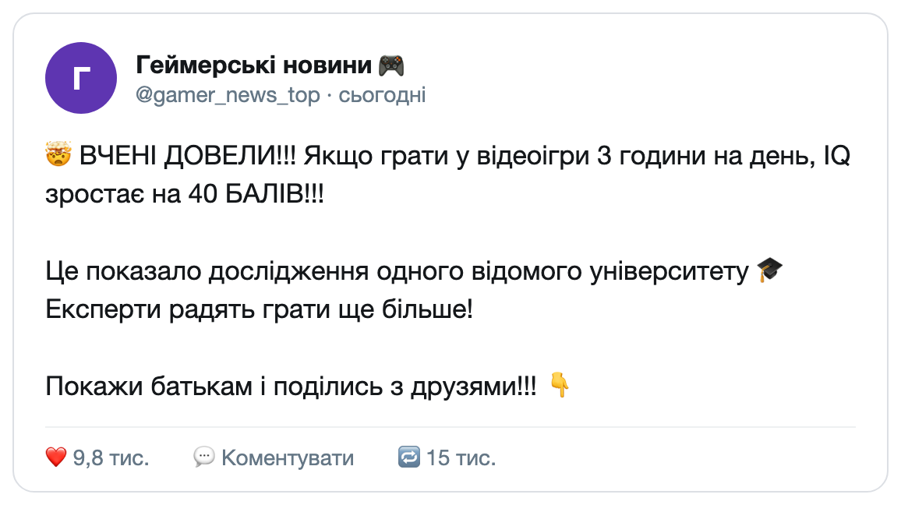

# Практична вправа: Фейк чи ні?

**Клас:** 9 | **Варіант:** — | **Дата:** ___________
**На основі уроків:** 17 «Фейки та їх розпізнавання» (підручник «Інформатика. 9 клас», УОВЦ «Оріон», с. 56–59)

> Під час виконання вправи можна користуватися пошуком в інтернеті, щоб перевірити факти.

### Рівень: Простий

**1.** Розгляньте допис. Це фейк чи достовірна інформація? *(див. зображення 1)*

- А) Фейк
- Б) Достовірна інформація

**2.** Розгляньте допис. Це фейк чи достовірна інформація? *(див. зображення 2)*

- А) Фейк
- Б) Достовірна інформація

**3.** Розгляньте допис. Це фейк чи достовірна інформація? *(див. зображення 3)*

- А) Фейк
- Б) Достовірна інформація

**4.** Розгляньте допис. Це фейк чи достовірна інформація? *(див. зображення 4)*

- А) Фейк
- Б) Достовірна інформація

**5.** Розгляньте допис. Це фейк чи достовірна інформація? *(див. зображення 5)*

- А) Фейк
- Б) Достовірна інформація

**6.** Сьогодні вранці однокласник переслав цей допис у чат класу. Чи можна йому вірити? *(див. зображення 6)*

- А) Так, заняття завтра скасовано — це офіційна інформація
- Б) Ні, це фейк: інформація застаріла і не стосується завтрашнього дня

**7.** Розгляньте допис. Це фейк чи достовірна інформація? *(див. зображення 7)*

- А) Фейк
- Б) Достовірна інформація

### Рівень: Середній

**8.** Які ознаки фейку є в цьому дописі? *(див. зображення 8; оберіть усі правильні варіанти)*

- [ ] А) Капс (великі літери) та багато знаків оклику
- [ ] Б) Обіцянка миттєвого ефекту («за одну ніч»)
- [ ] В) Посилання на наукове дослідження з назвою журналу
- [ ] Г) Посилання на невідому «блогерку Олену» замість фахівців
- [ ] Ґ) Заклик до негайних дій («лише сьогодні»)
- [ ] Д) Спокійний, нейтральний тон повідомлення

**9.** Друг отримав повідомлення «З 1 листопада WhatsApp стане платним» *(див. зображення 1)*. Які дії допоможуть перевірити, чи це правда? *(оберіть усі правильні варіанти)*

- [ ] А) Пошукати інформацію на офіційному сайті чи сторінці WhatsApp
- [ ] Б) Переслати повідомлення 10 друзям і подивитися, що станеться
- [ ] В) Пошукати цю новину в кількох надійних медіа
- [ ] Г) Повірити, бо повідомлення переслали вже 12 тисяч людей
- [ ] Ґ) Перевірити, чи писали про це сайти фактчекінгу (наприклад, StopFake, VoxCheck)
- [ ] Д) Запитати в коментарях під цим самим дописом

**10.** Зіставте ознаку фейку з прикладом:

| Ознака фейку | Приклад |
|---|---|
| А. Посилання на анонімних «експертів» | 1. «Негайно поділись із друзями!» |
| Б. Заклик до репосту | 2. «Схудни на 10 кг за 3 дні!» |
| В. Обіцянка чудо-засобу | 3. «Відомі лікарі підтвердили...» |
| Г. Застаріла інформація | 4. «ШОК! УСІ мають це побачити негайно!» |
| Ґ. Гучний емоційний заголовок | 5. Дата публікації: 01.01.2008 |

### Рівень: Складний

**11.** Розгляньте допис *(див. зображення 9)*. Перевірте його за алгоритмом: назвіть щонайменше дві фрази, що насторожують, і поясніть чому; сформулюйте два уточнювальні запитання; зробіть висновок — фейк це чи ні.

*Місце для відповіді:*

_______________________________________________

_______________________________________________

_______________________________________________

**12.** Уявіть: хтось поширив про вашого однокласника фейкову новину або змонтоване відео. Що він може відчувати? Які три дії йому варто зробити? До кого він може звернутися по допомогу?

*Місце для відповіді:*

_______________________________________________

_______________________________________________

_______________________________________________
