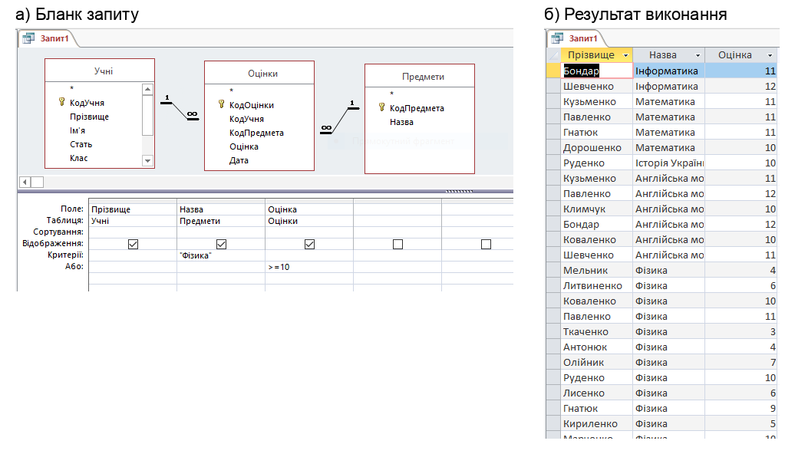

# Тематична контрольна робота: Інформація та інформаційна грамотність

**Клас:** 9 | **Варіант:** 1 | **Дата:** ___________
**На основі уроків:** 01–12 (Проєкт 1 «Моя майбутня професія: як ІТ змінюють світ і мої плани», Проєкт 2 «Професія: аналітик даних», Проєкт 3 «Професія: адміністратор бази даних школи», етапи 1–4)

**Прізвище, ім'я:** _______________________________ | **Час виконання:** 40 хв

Максимальний бал: 24

### Рівень: Простий

**1.** Для програміста цифрові технології — головний інструмент роботи, а для лікаря — допоміжний (медичні інформаційні системи, ЕКГ, ШІ для діагностики). Який висновок випливає з цього порівняння? *(оберіть одну відповідь)*

- А) Цифрова грамотність потрібна лише тим, хто працює в ІТ
- Б) Лікарям цифрові технології не потрібні
- В) Цифрова грамотність потрібна в будь-якій професії
- Г) У майбутньому всі лікарі стануть програмістами

**2.** Що таке інтелектуальний пошук даних в інтернеті? *(оберіть одну відповідь)*

- А) Пошук, який виконує лише штучний інтелект без участі людини
- Б) Пошук, під час якого використовують не лише ключові слова, а й логічне мислення, критичне оцінювання джерел і перевірку фактів
- В) Пошук за одним ключовим словом у будь-якому пошуковику
- Г) Перегляд усіх сайтів, які пошуковик показав на першій сторінці

**3.** Що таке цифрова ідентичність? *(оберіть одну відповідь)*

- А) Пароль, яким людина входить до своїх облікових записів
- Б) Те, як людину «бачать» інші в інтернеті на основі її цифрового сліду
- В) Номер паспорта, внесений до застосунку «Дія»
- Г) Унікальна адреса комп'ютера в мережі

**4.** Аналітик даних уже зібрав, упорядкував і проаналізував дані. Який крок алгоритму роботи аналітика він має виконати наступним? *(оберіть одну відповідь)*

- А) Зробити висновок
- Б) Повторно зібрати дані
- В) Візуалізувати
- Г) Сформулювати гіпотезу

**5.** Що таке система керування базами даних (СКБД)? *(оберіть одну відповідь)*

- А) Сфера діяльності, до якої належать дані бази (школа, бібліотека, аптека)
- Б) Програмне забезпечення для створення бази даних, введення, зберігання, пошуку та захисту даних
- В) Один рядок таблиці, що містить відомості про один об'єкт
- Г) Набір відкритих даних, опублікований на порталі data.gov.ua

**6.** Яку головну вимогу мають задовольняти значення первинного (ключового) поля таблиці? *(оберіть одну відповідь)*

- А) Бути унікальними для кожного запису таблиці
- Б) Бути лише текстовими
- В) Бути впорядкованими за алфавітом
- Г) Повторюватися в кожному записі таблиці

### Рівень: Середній

**7.** Які твердження про сортування та фільтрування в Таблицях Google правильні? *(оберіть усі правильні варіанти)*

- [ ] А) Фільтр приховує рядки, що не відповідають умові, але не видаляє їх із таблиці
- [ ] Б) Під час сортування рядки з однаковими значеннями автоматично видаляються
- [ ] В) Перед сортуванням діапазону (`Дані → Відсортувати діапазон`) потрібно виділити всю таблицю, а не лише один стовпець
- [ ] Г) Якщо застосувати фільтри до кількох стовпців одночасно, залишаться лише рядки, що задовольняють усі умови
- [ ] Д) Сортування числового стовпця «Від Я до А» впорядковує значення від найменшого до найбільшого
- [ ] Е) Усі вищеперелічені

**8.** Розгляньте логічну схему навчальної бази даних «Успішність» *(див. зображення 1)*. Які твердження правильні? *(оберіть усі правильні варіанти)*

- [ ] А) Первинним ключем таблиці *Учні* є поле *КодУчня*
- [ ] Б) Поле *КодПредмета* в таблиці *Оцінки* є зовнішнім ключем
- [ ] В) Зв'язок *Учні* — *Оцінки* має тип «один-до-багатьох»: один учень може мати багато оцінок
- [ ] Г) Таблиця *Оцінки* є головною щодо таблиці *Предмети*
- [ ] Д) Поле *Оцінка* має тип даних *Короткий текст*
- [ ] Е) Усі вищеперелічені

**9.** Адміністратор бази даних «Успішність» отримав три завдання. Зіставте кожне завдання з інструментом MS Access, яким його найзручніше виконати:

| Завдання | Інструмент MS Access |
|----------|----------------------|
| А. Відібрати в таблиці *Учні* тих, хто захоплюється музикою **або** літературою | 1. Перехресний запит |
| Б. Швидко знайти в таблиці *Учні* запис учня з прізвищем *Гнатюк* | 2. *Додатково — Змінити фільтр* (вкладка *Або*) |
| В. Отримати таблицю середніх балів, у якій рядки — предмети, а стовпці — класи | 3. *Знайти* (Ctrl+F) |

Відповіді: А — ___, Б — ___, В — ___

**10.** Заповніть пропуски (Конструктор запитів MS Access):

Щоб відібрати учнів зі зростом 175 см і вище, у рядку *Критерії* поля *Зріст* записують умову ___________. Якщо умови для двох різних полів записати в одному рядку *Критерії*, вони поєднуються логічною операцією ___________.

### Рівень: Складний

**11.** Аналітик перевіряє гіпотезу на даних Укртрансбезпеки про штрафи за I квартал 2026 року. На зображенні — 10 регіонів з найбільшою загальною сумою штрафів *(див. зображення 2)*:

> «Я думаю, що серед цих 10 регіонів сума штрафів на пасажирському транспорті перевищує 2 млн грн лише у двох — у Київській області та м. Києві й в Одеській області, бо там найбільші пасажиропотоки».

1. Яким інструментом Таблиць Google найзручніше перевірити цю гіпотезу? Вкажіть стовпець, умову та значення, які потрібно задати.
2. Скільки регіонів залишиться видимими після перевірки? Назвіть їх.
3. Сформулюйте висновок: підтвердилася гіпотеза чи ні? Обґрунтуйте конкретними числами.

*Місце для відповіді:*

_______________________________________________

_______________________________________________

_______________________________________________

_______________________________________________

_______________________________________________

**12.** Учень мав створити в базі даних «Успішність» запит, який відбирає оцінки **10 балів і вище з фізики**. На зображенні — бланк його запиту в *Конструкторі запитів* і результат виконання *(див. зображення 3)*. Замість кількох записів запит повернув 25.

1. Яку умову насправді задано в цьому запиті? Поясніть, яка логічна операція поєднує умови і чому.
2. Які записи потрапили в результат зайвими?
3. Як виправити бланк запиту, щоб він виконував поставлене завдання?

*Місце для відповіді:*

_______________________________________________

_______________________________________________

_______________________________________________

_______________________________________________

_______________________________________________
