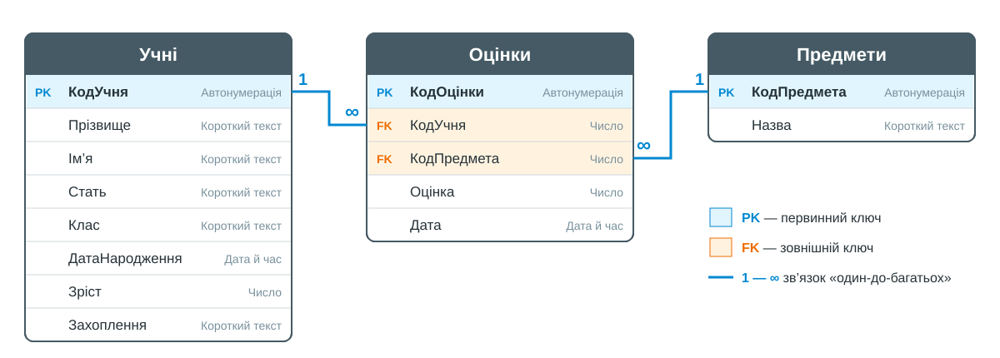
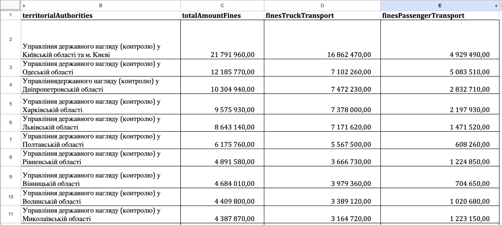
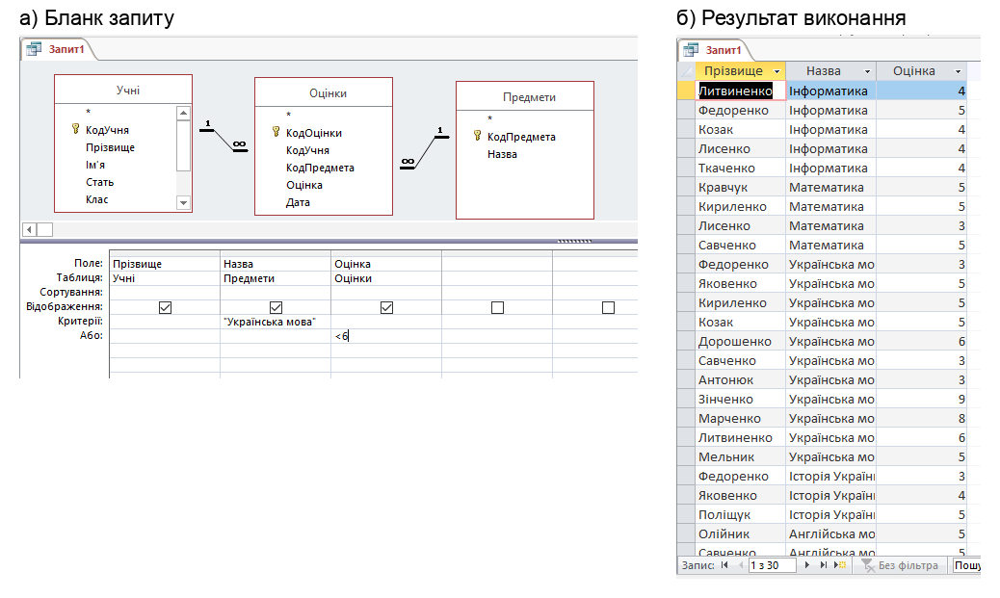

# Тематична контрольна робота: Інформація та інформаційна грамотність

**Клас:** 9 | **Варіант:** 2 | **Дата:** ___________
**На основі уроків:** 01–12 (Проєкт 1 «Моя майбутня професія: як ІТ змінюють світ і мої плани», Проєкт 2 «Професія: аналітик даних», Проєкт 3 «Професія: адміністратор бази даних школи», етапи 1–4)

**Прізвище, ім'я:** _______________________________ | **Час виконання:** 40 хв

Максимальний бал: 24

### Рівень: Простий

**1.** Одна учениця за допомогою YouTube і Google Docs готується до уроків, а інший учень «на 5 хвилин» відкриває TikTok і проводить там годину. Від чого насамперед залежить, чи стануть цифрові технології помічником, чи відволікаючим фактором? *(оберіть одну відповідь)*

- А) Від моделі смартфона чи комп'ютера
- Б) Від швидкості інтернету
- В) Від власного вибору, самодисципліни та мети використання
- Г) Від кількості встановлених застосунків

**2.** Яке з тверджень є гіпотезою, сформульованою за схемою «Я думаю, що… бо…», яку можна перевірити за допомогою даних? *(оберіть одну відповідь)*

- А) Математика — найцікавіший предмет у школі
- Б) Я думаю, що завтра буде гарний день
- В) Таблиці Google зручніші за MS Access
- Г) Я думаю, що в нашому класі найбільше учнів захоплюються спортом, бо в школі працює багато спортивних секцій

**3.** Що таке цифровий слід? *(оберіть одну відповідь)*

- А) Відбиток пальця, яким розблоковують смартфон
- Б) Усі сліди, які людина залишає онлайн: листи, повідомлення, фото, лайки, коментарі
- В) Маршрут, який прокладає навігатор у телефоні
- Г) Історія оновлень операційної системи комп'ютера

**4.** Яким є останній крок алгоритму роботи аналітика даних? *(оберіть одну відповідь)*

- А) Візуалізувати
- Б) Зібрати дані
- В) Впорядкувати
- Г) Зробити висновок

**5.** Що таке база даних? *(оберіть одну відповідь)*

- А) Програма для створення презентацій і звітів
- Б) Поіменована, структурована сукупність взаємопов'язаних даних, які належать до певної предметної області
- В) Будь-який файл, збережений на комп'ютері
- Г) Один стовпець таблиці з однотипними даними

**6.** Який тип даних MS Access автоматично присвоює кожному новому запису ціле число, що збільшується, і тому найчастіше використовується для ключового поля? *(оберіть одну відповідь)*

- А) Короткий текст
- Б) Число
- В) Автонумерація
- Г) Так/ні

### Рівень: Середній

**7.** Що аналітик перевіряє, оцінюючи якість набору відкритих даних на порталі data.gov.ua? *(оберіть усі правильні варіанти)*

- [ ] А) Хто опублікував набір даних
- [ ] Б) Скільки людей переглянули сторінку набору даних
- [ ] В) Коли востаннє оновлювали дані
- [ ] Г) Чи є дані у форматі, який можна відкрити в таблицях (CSV, XLSX тощо)
- [ ] Д) Чи оформлено таблицю кольоровими заливками
- [ ] Е) Усі вищеперелічені

**8.** Розгляньте логічну схему навчальної бази даних «Успішність» *(див. зображення 1)*. Які твердження правильні? *(оберіть усі правильні варіанти)*

- [ ] А) Первинним ключем таблиці *Предмети* є поле *КодПредмета*
- [ ] Б) Поле *КодУчня* в таблиці *Оцінки* є первинним ключем цієї таблиці
- [ ] В) Зв'язок *Предмети* — *Оцінки* має тип «один-до-багатьох»: з одного предмета може бути багато оцінок
- [ ] Г) Поле *КодОцінки* має тип даних *Автонумерація*
- [ ] Д) Один запис таблиці *Оцінки* може належати одразу кільком учням
- [ ] Е) Усі вищеперелічені

**9.** Адміністратор бази даних школи визначає типи даних для полів нової таблиці. Зіставте кожне поле з найвідповіднішим типом даних MS Access:

| Поле | Тип даних |
|------|-----------|
| А. Номер телефону | 1. Так/ні |
| Б. Наявність пільги | 2. Грошова одиниця |
| В. Ціна квитка | 3. Короткий текст |

Відповіді: А — ___, Б — ___, В — ___

**10.** Заповніть пропуски (Конструктор запитів MS Access):

Щоб відібрати учнів, які захоплюються спортом, у рядку *Критерії* поля *Захоплення* записують умову ___________. Щоб поле використовувалося в умові, але не показувалося в результаті запиту, знімають позначку в рядку ___________.

### Рівень: Складний

**11.** Аналітик перевіряє гіпотезу на даних Укртрансбезпеки про штрафи за I квартал 2026 року. На зображенні — 10 регіонів з найбільшою загальною сумою штрафів *(див. зображення 2)*:

> «Я думаю, що серед цих 10 регіонів сума штрафів на вантажному транспорті менша за 4 млн грн лише у двох — Волинській і Рівненській областях, бо там менше промислових підприємств і вантажних перевезень».

1. Яким інструментом Таблиць Google найзручніше перевірити цю гіпотезу? Вкажіть стовпець, умову та значення, які потрібно задати.
2. Скільки регіонів залишиться видимими після перевірки? Назвіть їх.
3. Сформулюйте висновок: підтвердилася гіпотеза чи ні? Обґрунтуйте конкретними числами.

*Місце для відповіді:*

_______________________________________________

_______________________________________________

_______________________________________________

_______________________________________________

_______________________________________________

**12.** Учень мав створити в базі даних «Успішність» запит, який відбирає оцінки **нижче 6 балів з української мови**. На зображенні — бланк його запиту в *Конструкторі запитів* і результат виконання *(див. зображення 3)*. Замість кількох записів запит повернув 30.

1. Яку умову насправді задано в цьому запиті? Поясніть, яка логічна операція поєднує умови і чому.
2. Які записи потрапили в результат зайвими?
3. Як виправити бланк запиту, щоб він виконував поставлене завдання?

*Місце для відповіді:*

_______________________________________________

_______________________________________________

_______________________________________________

_______________________________________________

_______________________________________________
